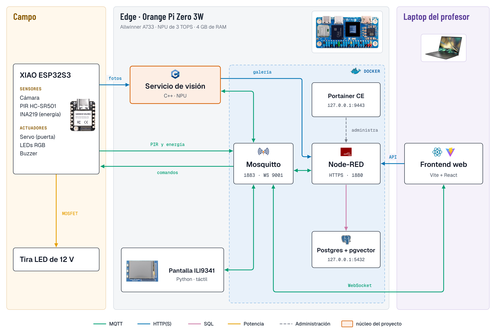

# AutoList: pase de lista con reconocimiento facial en Edge AI

> Última actualización: 2 nov 2026. Actualizamos este README con cada avance significativo; resume el estado del proyecto. El detalle técnico está en [`docs/HIGH-LEVEL-PLAN.md`](docs/HIGH-LEVEL-PLAN.md).

## Datos generales

### Materia

Fundamentos de Sistemas Embebidos 2027-1

### Profesor

Eduardo Fragoso Navarro

### Equipo

- Jiménez Ayala Yordi Josué
- Solé Pi Arnau Roger
- Valenzuela Ascencio Gustavo

### Plataforma Edge AI

Orange Pi Zero 3W (Allwinner A733, NPU de 3 TOPS, 4 GB de RAM)

---

## Qué hace el proyecto

AutoList automatiza el pase de lista y verifica que cada alumno esté físicamente en el aula. El reconocimiento facial corre en la NPU de la Orange Pi, sin servicios en la nube. Como antecedente existe un [proyecto previo de pase de lista por Bluetooth](https://github.com/Yordi-JA/Pase-de-Asitencia-Bluetooth-Proyecto-Final-Sistemas-de-comunicaciones), que registraba la asistencia pero no verificaba la identidad.

El sistema:
- detecta al alumno con un PIR, toma fotos con la XIAO ESP32S3 y lo identifica en la NPU;
- registra presente o retardo según la tolerancia de la sesión, con lista maestra y anti-doble registro;
- da retroalimentación física: servo como puerta simulada, LEDs RGB, buzzer y una tira LED de 12 V (vía MOSFET) que ilumina la cara;
- guarda todo en Postgres y lo muestra en un frontend web y en una pantalla táctil ILI9341;
- mide el consumo energético con un INA219 para el reporte de costo y consumo.

Alcance completo (incluye, opcional y fuera de alcance): [plan, sección 2](docs/HIGH-LEVEL-PLAN.md#2-alcance). Trazabilidad con los requisitos de la materia: [sección 3](docs/HIGH-LEVEL-PLAN.md#3-trazabilidad-con-los-requisitos-del-documento).

## Arquitectura



La fuente editable del diagrama es [`docs/diagramas/arquitectura.svg`](docs/diagramas/arquitectura.svg). Detalle de capas y protocolos: [sección 4](docs/HIGH-LEVEL-PLAN.md#4-arquitectura).

## Cómo funciona

En el pase de lista, el PIR de la XIAO detecta movimiento. El servicio de visión enciende la luz, pide una ráfaga de fotos y se queda con la más nítida. En la NPU detecta el rostro, lo alinea, calcula su embedding y lo compara con la galería. Node-RED recibe el resultado, aplica las reglas de la sesión, guarda la asistencia en Postgres y ordena al servo y a los LEDs que respondan. Detalle: [sección 5.1](docs/HIGH-LEVEL-PLAN.md#51-pase-de-lista-flujo-directo).

Para registrar alumnos, el profesor importa la lista maestra en CSV. Después, con el consentimiento de cada alumno, registra su rostro desde el frontend con 5 poses que la ILI9341 le va indicando al alumno. Detalle: [sección 5.4](docs/HIGH-LEVEL-PLAN.md#54-registro-de-alumnos-enrolamiento).

El flujo inverso va de la pantalla a los actuadores: los botones "Abrir puerta" y "Probar luz LED" publican por MQTT hacia la XIAO. Detalle: [sección 5.2](docs/HIGH-LEVEL-PLAN.md#52-control-flujo-inverso).

Tópicos MQTT y esquema de la base: [sección 7](docs/HIGH-LEVEL-PLAN.md#7-datos) y [`docs/contrato-mqtt.md`](docs/contrato-mqtt.md).

## Componentes

| Componente | Tecnología | Carpeta | Estado |
|---|---|---|---|
| Stack del edge | Docker: Mosquitto, Node-RED (HTTPS), Postgres + pgvector, Portainer | `orangepi/`, `nodered/` | Funcionando: ingesta y API de energía, ACL de Mosquitto con usuarios por rol (contrato MQTT v0.5) y frontend servido en `/app/` |
| Servicio de visión | C++20 nativo con systemd, NPU (VIPLite), OpenCV 4.6 | `orangepi/vision` | Proceso de producción, adaptadores reales de MQTT y HTTP, contrato MQTT v0.3, unidad systemd y pruebas; faltan los modelos `.nb`, el detector y el embedder sobre la NPU |
| Firmware de campo | XIAO ESP32S3, Arduino C++, MQTT y HTTP | `firmware/xiao` | Placa y cámara disponibles; firmware sin iniciar |
| Pantalla | Python en el host (systemd), ILI9341 + táctil XPT2046, RTC DS3231 | `orangepi/pantalla`, `orangepi/systemd` | Pantalla disponible; software sin iniciar |
| Frontend web | Vite + React + TypeScript, servido por Node-RED | `web/` | Esqueleto con la vista de energía (cifras, gráfica de potencia y tabla); faltan las vistas de Alumnos y Registro |

Modelos decididos: RetinaFace para detección e InsightFace `w600k_mbf` (MobileFaceNet, embedding de 512) para reconocimiento ([sección 6.2](docs/HIGH-LEVEL-PLAN.md#62-servicio-de-visión-orangepivision-c-nativo)). Hardware y pines: [sección 8](docs/HIGH-LEVEL-PLAN.md#8-hardware). Estructura del repositorio: [sección 11](docs/HIGH-LEVEL-PLAN.md#11-estructura-del-repositorio).

## Entregables y avance

Las fechas tentativas salen del [plan, sección 12.1](docs/HIGH-LEVEL-PLAN.md#121-hitos). Cada hito es un miércoles.

### Resumen

| Fecha | Hito | Estado |
|---|---|---|
| 28 oct | Proyecto y planeación | Hecho; la lista de compras pasó al 4 nov |
| 4 nov | Primer avance | Parcial: 5 de 9 entregables listos y 3 a medias (la ingesta y el gráfico de energía esperan al INA219); el toolchain Pegasus y el `.nb` pasaron al 11 nov |
| 11 nov | Segundo avance | Parcial: la alineación y la galería del servicio de visión, y el armazón del frontend, ya están adelantados |
| 18 nov | Tercer avance | Parcial: el filtro de nitidez y la parte de energía de la pestaña de Métricas ya están adelantados |
| 25 nov | Entrega final | Pendiente |

### 28 oct: Proyecto y planeación

| Entregable | Estado | Evidencia |
|---|---|---|
| Especificación del proyecto | Hecho | [`docs/HIGH-LEVEL-PLAN.md`](docs/HIGH-LEVEL-PLAN.md) |
| Exposición | Hecho | |
| Repositorio y estructura | Hecho | `orangepi/`, `nodered/`, `herramientas/` y guías para agentes (`AGENTS.md`) |
| Lista de compras | Reprogramada | Pasó al 4 nov (ver la nota) |

> Nota sobre la lista de compras: la aplazamos del 28 oct al 4 nov. Al reordenar el plan por dependencias, adelantamos al primer avance dos tareas que estaban en entregas posteriores (las que dicen "adelantado" en la tabla del 4 nov). Por eso el ajuste de una semana no recorre el resto del calendario.

### 4 nov: Primer avance

| Entregable | Estado | Evidencia |
|---|---|---|
| Lista de compras (reprogramada desde el 28 oct) | Pendiente | |
| NPU verificada en la imagen oficial de Orange Pi | Hecho | `vipcore` 1.13.0, `vpm_run` a 2.76 ms; prueba `orangepi/vision/apps/npu_smoke.cpp` |
| Overlays de SPI (`/dev/spidev*`) y unidad systemd de la pantalla | Parcial | La placa expone `/dev/spidev3.0` y `/dev/spidev3.1`; falta `orangepi/systemd/orangepi-pantalla.service` |
| Compose de la Orange Pi (Mosquitto, Node-RED, Postgres, Portainer) | Hecho | [`orangepi/docker-compose.yml`](orangepi/docker-compose.yml) |
| Esquema de Postgres | Hecho | [`orangepi/sql/schema.sql`](orangepi/sql/schema.sql) y rol de Node-RED con privilegios mínimos |
| Ingesta a `metricas_energia` | Parcial | El flujo de energía en Node-RED ya está; solo falta el medidor (INA219) para probarlo con lecturas reales, y esa prueba pasa al 11 nov. No usamos datos simulados como evidencia |
| Primer gráfico de energía | Parcial | La vista de energía en `https://<ip>:1880/app/` ya está (gráfica de potencia de los últimos 30 min y tabla de lecturas sobre `GET /api/metricas/energia`); sin el INA219 muestra su estado vacío. La prueba con datos reales pasa al 11 nov |
| Arranque del esqueleto del frontend (adelantado del 11 nov) | Hecho | [`web/`](web/README.md), compilado dentro de la imagen de Node-RED |
| ACL de Mosquitto y usuarios por rol (adelantado del 25 nov) | Hecho | [`orangepi/mosquitto/acl`](orangepi/mosquitto/acl) y [contrato MQTT v0.5](docs/contrato-mqtt.md), sección 6; verificada en la placa con permitidos y denegados por usuario |

### 11 nov: Segundo avance

| Entregable | Estado | Evidencia |
|---|---|---|
| Toolchain Pegasus en la PC (movido del 4 nov) | Pendiente | Versión decidida: Acuity v2.0.10.2 |
| Modelo de la NPU convertido a `.nb` (movido del 4 nov) | Pendiente | |
| Detección, alineación y embedding en la NPU | Parcial | Alineación a 112×112 implementada y probada; faltan el detector y el embedder sobre la NPU |
| Galería y publicación del resultado | Parcial | Galería en RAM con similitud coseno, contrato MQTT v0.3, adaptadores reales de MQTT y HTTP y proceso de producción con configuración y señales |
| Orden de enrolar con captura de 5 poses | Parcial | Máquina de estados del registro probada con dobles en memoria |
| MOSFET y tira LED de 12 V; orquestación de luz y captura | Pendiente | |
| XIAO: `/capture`, PIR e INA219 por MQTT; servo y LEDs por MQTT | Pendiente | La placa y su cámara ya están; el PIR, el INA219 y el servo dependen de las compras |
| Pruebas unitarias de la XIAO (cámara, INA219, servo) | Pendiente | |
| Prueba temprana: servo moviéndose mientras la cámara captura | Pendiente | |
| RTC DS3231 e integración del hardware de la pantalla | Pendiente | |
| Flujos de pase de lista y de sesiones en Node-RED | Pendiente | |
| Reinicio de la pantalla por MQTT y nodo `exec` del reporte CSV | Pendiente | |
| API de alumnos e importación de CSV | Parcial: implementado en el repo, falta desplegar y verificar en la placa | `GET /api/alumnos`, `POST /api/alumnos/importar` (CSV, con 400 y 409 antes de escribir) y `GET /api/galeria` en `nodered/flows/flows.json`; formato en el [plan, sección 6.7](docs/HIGH-LEVEL-PLAN.md#67-frontend-web-de-registro-web-vite--react--typescript) |
| Esqueleto del frontend | Parcial | Adelantado al 4 nov: navegación, selector de tema y vista de energía; Alumnos y Registro solo tienen su estado vacío |
| Menú base de la pantalla (sesión, lista y guía de registro) | Pendiente | |
| Autenticación de la API en Node-RED (`httpNodeMiddleware`) y `GALERIA_TOKEN` (antes "`httpNodeAuth`") | Parcial: implementado en el repo, falta desplegar y verificar en la placa | Basic del profesor en `/api/*` y solo `X-Galeria-Token` en `/api/galeria` (`nodered/autenticacion-api.js`); variables nuevas en `orangepi/.env.example` |
| Prueba de la ingesta y del gráfico de energía con el INA219 (pospuesta del 4 nov) | Pendiente | El flujo y la vista ya están; depende de la compra del INA219 y de su publicación MQTT desde la XIAO |

### 18 nov: Tercer avance

| Entregable | Estado | Evidencia |
|---|---|---|
| Filtro de calidad y mejora de imagen | Parcial | Filtro de nitidez (varianza del Laplaciano) implementado y probado; falta la mejora de imagen (CLAHE y gamma) |
| Validaciones y chequeo antifraude del registro | Pendiente | |
| Experimentos E1 a E5 ([sección 9](docs/HIGH-LEVEL-PLAN.md#9-experimentos)) | Pendiente | |
| Umbral de similitud calibrado con LFW | Pendiente | |
| Frontend de registro completo, con la pestaña de Métricas y Asistencia | Parcial | La pestaña de Métricas ya muestra la energía; faltan asistencia, latencia y confianza, y las vistas de Alumnos y Registro |
| Pantalla completa con sus 3 vistas y los botones de control | Pendiente | |

### 25 nov: Entrega final

| Entregable | Estado |
|---|---|
| Integración del sistema completo | Pendiente |
| Video | Pendiente |
| Reporte de costo y consumo ([sección 10](docs/HIGH-LEVEL-PLAN.md#10-análisis-de-costo-y-consumo-para-el-reporte)) | Pendiente |
| Comprimido de código | Pendiente |
| Pulido del frontend y de la pantalla | Pendiente |
| Experimento E6 (comparación con el proyecto previo) | Pendiente |

## Próximos pasos

Para el 4 nov falta esto del primer avance:
- Hacer las compras. Ya tenemos la Orange Pi, la pantalla y la XIAO con su cámara; faltan el servo, el INA219, el PIR, el MOSFET y la tira LED de 12 V, sin los cuales no avanzan los sensores y actuadores de la XIAO ni la etapa de potencia.
- Crear la unidad systemd de la pantalla (los overlays de SPI ya exponen `/dev/spidev3.0` y `/dev/spidev3.1`).

Movido al 11 nov: instalar el toolchain Pegasus (Acuity v2.0.10.2) y convertir RetinaFace y `w600k_mbf` a `.nb`, y probar la ingesta y el gráfico de energía con el INA219.

Después, en orden de dependencia, siguen los modelos `.nb`, el detector y el embedder en la NPU, el primer pase de lista real, los flujos de pase de lista y de registro, y el frontend de registro. Los adaptadores reales de MQTT y HTTP en la visión y el proceso de producción (configuración, señales y unidad systemd) se adelantaron, porque dependían del toolchain de modelos, que todavía no está: sin los `.nb` no hay detector ni embedder, pero el cableado entre broker, cámara, galería y servicio sí se puede dejar cerrado y probado. La captura de fotos de la XIAO (`/capture`) puede empezar ya; sus sensores y actuadores esperan las compras. Dependencias completas: [sección 12.3](docs/HIGH-LEVEL-PLAN.md#123-dependencias-entre-tareas).

## Riesgos abiertos

Resumen de la [sección 13](docs/HIGH-LEVEL-PLAN.md#13-riesgos) y de los pendientes de [`orangepi/README.md`](orangepi/README.md#seguridad-y-riesgos-aceptados).

| Riesgo | Impacto | Mitigación |
|---|---|---|
| Compras sin hacer (servo, INA219, PIR, MOSFET y tira LED) | Los sensores, los actuadores y la etapa de potencia se acumulan en el hito del 11 nov | Comprar en la semana del 4 nov; mientras tanto, avanzar la captura de la XIAO. La prueba de la ingesta y del gráfico de energía espera al INA219: no usamos datos simulados como evidencia |
| Compatibilidad del `.nb` con el driver de la NPU | Un `.nb` incompatible o una actualización del kernel rompen la inferencia | Acuity v2.0.10.2 para `vipcore` 1.13.0; no actualizar el kernel sin volver a verificar la NPU |
| Precisión del modelo cuantizado | Más falsos positivos o rechazos | Pasar a cuantización int16 o mixta, o a `w600k_r50` (mismo embedding de 512) |
| Conflictos de hardware en la XIAO: timers LEDC, I²C compartido con la cámara y GPIO3 de strapping | El servo, el INA219 o la consola USB pueden fallar | Las verificaciones que describe el plan, en cuanto se conecten los componentes |
| La cámara no se autentica | Alguien en la LAN podría inyectar o leer fotos | Decisión pendiente del equipo: HMAC, punto de acceso dedicado o TLS ([`orangepi/vision/README.md`](orangepi/vision/README.md#limitaciones-conocidas)) |
| La API HTTP de la placa desplegada aún sin autenticación | Cualquier equipo de la red llega a la API de Node-RED desplegada | MQTT ya tiene ACL con usuarios por rol (contrato v0.5); la autenticación de la API (Basic del profesor y `GALERIA_TOKEN`) está en el repo y falta desplegarla y verificarla; mientras tanto no registramos a ninguna persona real |
| MQTT (1883) sin TLS | La contraseña de la XIAO viaja en claro por la LAN; con una clave filtrada se expulsa al cliente legítimo y se inyectan lecturas | Los consumidores descartan mensajes retenidos y vacíos; quedan pendientes limitar el 1883 a la IP de la XIAO en el firewall del host y decidir TLS ([`orangepi/README.md`](orangepi/README.md#seguridad-y-riesgos-aceptados)) |
| Todo el stack en 4 GB de RAM | Visión, Docker y pantalla compiten por memoria | Vigilar la RAM con las métricas del SoC |

## Documentación

| Documento | Contenido |
|---|---|
| [`docs/HIGH-LEVEL-PLAN.md`](docs/HIGH-LEVEL-PLAN.md) | Plan de alto nivel: alcance, arquitectura, flujos, datos, hardware, experimentos, plan semanal y riesgos |
| [`docs/contrato-mqtt.md`](docs/contrato-mqtt.md) | Contrato de tópicos y payloads MQTT entre módulos |
| [`orangepi/README.md`](orangepi/README.md) | Operación del stack del edge: credenciales, arranque, acceso, energía y seguridad |
| [`orangepi/vision/README.md`](orangepi/vision/README.md) | Servicio de visión: estructura, compilación, pruebas y lo que falta |
| [`web/README.md`](web/README.md) | Frontend web: desarrollo desde la laptop, despliegue y decisiones de diseño |
| [`AGENTS.md`](AGENTS.md) | Reglas del repo: carriles, ramas, commits y seguridad de datos |
| [`docs/diagramas/arquitectura.svg`](docs/diagramas/arquitectura.svg) | Fuente editable del diagrama de arquitectura |

## Instalación y ejecución

> Hoy existen el stack del edge (con el frontend web) y el servicio de visión. Completaremos esta sección cuando estén el firmware y la pantalla.

### Stack del edge (en la Orange Pi)

Requisitos: Docker Compose 2.23.1 o posterior, arm64 y `openssl`. Guía completa: [`orangepi/README.md`](orangepi/README.md).

```bash
git clone https://github.com/GustavoVaAsc/AutoList.git
cd AutoList/orangepi
cp .env.example .env && chmod 600 .env   # sustituir cada cambiar_esta_clave con: openssl rand -hex 16
docker compose up -d --build
docker compose ps                        # mosquitto, postgres y nodered deben estar healthy
```

Node-RED responde en `https://<ip>:1880` (editor en `/`, API en `/api/` y frontend en `/app/`); para entrar por la IP de la placa, agrégala a `NODERED_TLS_SAN` en `.env`. Portainer solo escucha en la placa: desde otro equipo, abre un túnel con `ssh -L 9443:localhost:9443 orangepi@<ip>` y entra a `https://localhost:9443`.

Para generar lecturas de prueba, ejecuta `herramientas/simular_energia.sh 5 1` desde la raíz del repo. Antes de que la XIAO publique datos reales, borra las lecturas simuladas con `--limpiar` ([detalle](orangepi/README.md#simulador)).

`orangepi/.env` tiene credenciales reales y nunca se sube al repo.

### Servicio de visión (en la Orange Pi)

Requisitos: g++ 12, CMake 3.16 o posterior, `libopencv-dev` 4.6, `libmosquitto-dev`, `libcpp-httplib-dev`, `nlohmann-json3-dev` y el runtime VIPLite del fabricante. Guía completa: [`orangepi/vision/README.md`](orangepi/vision/README.md).

```bash
cd orangepi/vision
cmake -S . -B build
cmake --build build -j4
ctest --test-dir build --output-on-failure
```

`build/vision_service` es el binario de producción: el que lanza systemd, el que lee `/etc/pase-lista/vision.conf`, se conecta al broker y pide las fotos a la cámara. `build/vision_dry_run` es el recorrido en seco con dobles en memoria. `build/npu_smoke` mide una inferencia en la NPU. Los modelos `.nb` no se versionan.

La prueba de humo (`tools/humo.sh`) verifica el cableado completo de punta a punta con su propio broker de pruebas (puerto 1884) y su propia cámara falsa: publica un PIR y comprueba que llega el resultado, que se publica el estado y que la luz se enciende y se apaga. No toca los contenedores del proyecto `pase-lista`.

```bash
cd orangepi/vision
tools/humo.sh
```

### Por definir

Firmware de la XIAO (`firmware/xiao`) y pantalla ILI9341 (`orangepi/pantalla` y su unidad systemd).
