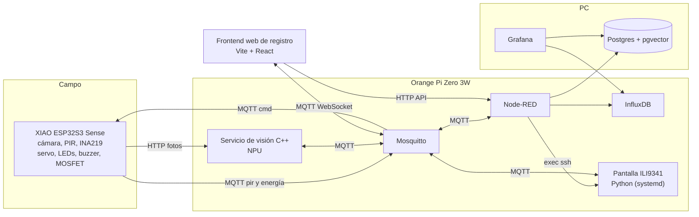
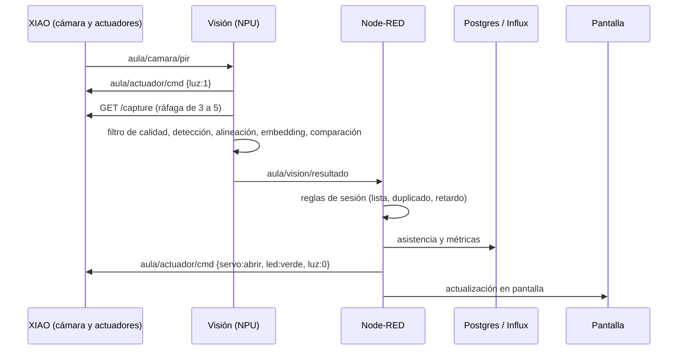
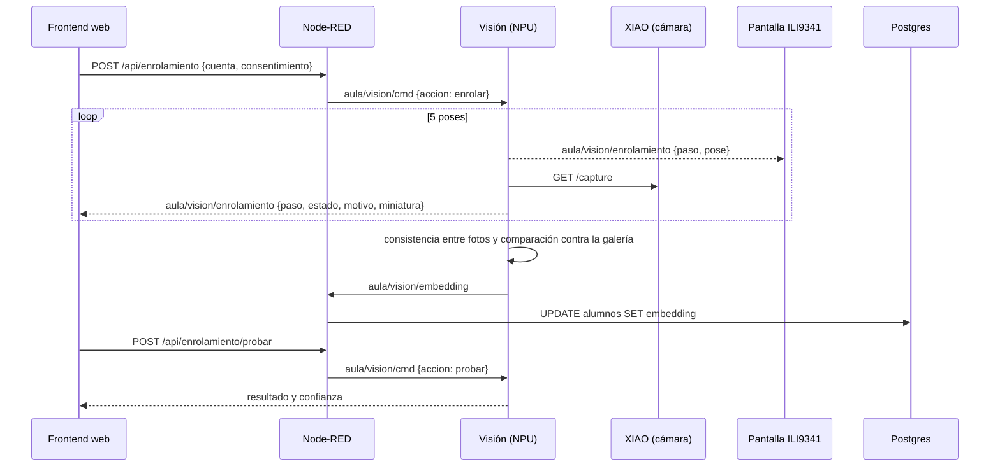

# Pase de lista con reconocimiento facial en Edge AI

**Materia:** Fundamentos de Sistemas Embebidos 2027-1
**Profesor:** Eduardo Fragoso Navarro
**Equipo:** Gustavo · Yordi · Arnau
**Plataforma Edge AI:** Orange Pi Zero 3W (Allwinner A733, NPU de 3 TOPS, 4 GB de RAM)

> Documento vivo. Si una decisión cambia, actualízala aquí; en el [registro de decisiones del documento interno](SPEC.md#2-registro-de-decisiones) solo se anota cuando la decisión en sí cambia.

---

## 1. Problema y objetivo

El pase de lista manual consume tiempo de clase y es propenso a errores. El proyecto previo del equipo ([pase de lista por Bluetooth con Arduino Nano](https://github.com/Yordi-JA/Pase-de-Asitencia-Bluetooth-Proyecto-Final-Sistemas-de-comunicaciones)) automatizó el registro, pero no verificaba la identidad: la app permitía enviar cualquier número de cuenta, así que un alumno podía registrar a otro desde dentro del salón.

**Objetivo:** automatizar el pase de lista verificando la presencia física de cada alumno mediante reconocimiento facial ejecutado localmente en la NPU de la Orange Pi. El sistema registra presente o retardo, da retroalimentación física (puerta simulada con servo), almacena y visualiza los datos, y genera reportes sin depender de servicios en la nube.

## 2. Alcance

**Incluye**
- Reconocimiento facial en la NPU: detección, alineación y embedding.
- Registro de alumnos (enrolamiento) desde un frontend web, con la ILI9341 guiando al alumno frente a la cámara. La pantalla tiene tres vistas: sesión, lista y guía de registro.
- Importación de la lista maestra desde CSV.
- Sesiones de clase con tolerancia de retardo.
- Reglas heredadas del proyecto previo: lista maestra y anti-doble registro.
- Retroalimentación física: servo como puerta simulada, LEDs RGB y buzzer.
- Etapa de potencia: MOSFET que enciende una tira LED de 12 V para iluminar la cara.
- Almacenamiento en InfluxDB y Postgres, visualización en Grafana y en la ILI9341.
- Mejora de imagen para la cámara.
- Medición de consumo energético.

**Opcional**
- Detección de rostro en la propia XIAO ESP32S3 (cascada con la NPU).
- Detección de vida (antispoofing).

**Fuera de alcance**
- Cerradura física real.
- Integración con sistemas escolares.
- Bluetooth.
- App móvil.

## 3. Trazabilidad con los requisitos del documento

| Requisito | Cómo se cumple |
|---|---|
| 1–2. Campo de aplicación con los elementos de la Fig. 1 | Pase de lista verificable en el aula |
| 3. La ESP32 lee los sensores y los envía a la Orange Pi | La XIAO ESP32S3 lee cámara, PIR e INA219 y los envía por HTTP y MQTT; además maneja los actuadores |
| 4. Docker: Mosquitto, InfluxDB y Node-RED en la Orange Pi; base de datos y Grafana en la PC | `orangepi/docker-compose.yml` y `pc/docker-compose.yml` (Postgres con pgvector en lugar de MariaDB) |
| 5. Node-RED redistribuye a InfluxDB y a la base de datos, con un nodo que ejecuta el Python de la pantalla | Flujos de ingesta y pase de lista, más un nodo `exec` que reinicia la pantalla por SSH |
| 6. Programa de Python para la ILI9341 con menú | `orangepi/pantalla/`, complementado con el frontend web de registro (`web/`), que corresponde a la opción "HTML" de la Fig. 1 |
| 7. Base de datos y Grafana en la PC | Postgres con pgvector y paneles de Grafana |
| Nota: flujo inverso hasta el actuador, con etapa de potencia | Pantalla → MQTT → XIAO ESP32S3 → servo, LEDs y MOSFET con tira LED de 12 V |
| Entregables: reporte con costo y consumo | Experimentos E5 y análisis de costo (sección 10) |

## 4. Arquitectura



| Capa | Dispositivo | Responsabilidad |
|---|---|---|
| Campo | XIAO ESP32S3 Sense | Fotos bajo demanda (HTTP); PIR e INA219 (MQTT); servo, LEDs RGB, buzzer y MOSFET de la tira LED de 12 V (MQTT) |
| Borde | Orange Pi Zero 3W | Servicio de visión (NPU), Docker (Mosquitto, Node-RED, InfluxDB), pantalla ILI9341, RTC DS3231, frontend web (servido por Node-RED) |
| Almacenamiento | PC | Docker (Postgres con pgvector, Grafana) |
| Administración | Navegador de la laptop del profesor | Frontend web de registro de alumnos |

**Protocolos:**
- **HTTP:** imágenes de la cámara.
- **MQTT:** telemetría, resultados y comandos.
- **MQTT sobre WebSocket (puerto 9001):** progreso del registro en el frontend.
- **HTTP (Node-RED):** frontend estático y API de alumnos y registro.
- **SQL por LAN:** de Node-RED a Postgres.

## 5. Flujos

### 5.1 Pase de lista (flujo directo)



1. El PIR de la XIAO detecta movimiento y lo publica.
2. El servicio de visión enciende la tira LED, espera unos 300 ms a que la exposición se estabilice y pide una ráfaga de fotos en alta resolución.
3. Filtro de calidad: elige la foto más nítida (varianza del Laplaciano). Si ninguna pasa el umbral, publica `motivo: imagen_insuficiente`.
4. En la NPU, detecta el rostro y sus 5 puntos clave, alinea la cara a 112×112 y calcula el embedding.
5. Compara contra la galería local por similitud coseno y publica el resultado con sus latencias.
6. Node-RED aplica las reglas de la sesión:
   - el alumno está en la lista del grupo;
   - no está ya registrado en la sesión;
   - se clasifica como presente o retardo según la tolerancia.
7. Node-RED guarda en Postgres e InfluxDB y manda la retroalimentación:
   - **verde:** registrado, y el servo abre;
   - **rojo:** desconocido o ya registrado;
   - **ámbar:** zona gris de confianza; se repite la captura y, si persiste, el profesor lo marca manualmente desde la pantalla.

### 5.2 Control (flujo inverso)

- **Automático:** Node-RED → `aula/actuador/cmd` → XIAO ESP32S3.
- **Manual:** desde la pantalla se puede abrir el servo, probar LEDs y buzzer, e iniciar o terminar la sesión.

### 5.3 Sesión de clase

El profesor inicia la sesión con materia, grupo y tolerancia. Node-RED crea el registro en Postgres y publica `aula/sesion/estado`; la XIAO enciende el LED azul. Al terminar, se genera el reporte de presentes, retardos y faltas (sección 7.3).

### 5.4 Registro de alumnos (enrolamiento)

El registro tiene dos partes: primero se da de alta al alumno en la lista maestra y después se le asocia su rostro. Todo se controla desde el frontend web; la captura siempre se hace con la XIAO y el embedding siempre se calcula en la NPU, con el mismo pipeline del pase de lista.

**Parte 1: lista maestra (una vez por grupo).** El profesor sube un CSV (`no_cuenta,nombre,grupo`) desde el frontend. Node-RED lo inserta en `alumnos` con `embedding = NULL`, así que cada alumno queda **pendiente de rostro**.

**Parte 2: registro del rostro.**



> Las flechas punteadas son mensajes MQTT que llegan al frontend y a la pantalla por Mosquitto.

1. El profesor elige a un alumno pendiente en el frontend y marca el consentimiento. Sin consentimiento, el botón de inicio está deshabilitado.
2. Node-RED valida que el alumno exista y publica la orden de registro.
3. El servicio de visión enciende la tira LED y toma 5 fotos, una por pose: de frente, un poco a la izquierda, un poco a la derecha, un poco hacia arriba y de frente otra vez. La ILI9341 le muestra la pose al alumno, que no ve la laptop del profesor.
4. Cada foto se valida: exactamente un rostro, cara de al menos ~100 px de ancho, nitidez mínima y giro de cabeza moderado. Si se rechaza, el frontend muestra el motivo y se repite esa pose.
5. Se calcula el embedding de cada foto en la NPU. Los que se alejan mucho del resto se descartan; los demás se promedian y se normalizan.
6. **Chequeo antifraude:** si el nuevo embedding se parece mucho al de otro alumno ya registrado, el frontend muestra una advertencia y el profesor decide si continúa.
7. Node-RED guarda el embedding en Postgres (es el único que escribe en la base) y el servicio de visión actualiza su galería local. Las fotos se descartan: las miniaturas solo pasan por el navegador y el embedding nunca llega al frontend.
8. **Prueba inmediata:** el alumno se para frente a la cámara y el frontend muestra el resultado y la confianza.

**Reglas del registro:**
- **Mismo pipeline siempre.** El embedding del registro se calcula con el mismo modelo cuantizado en la NPU que el pase de lista. Registrar con el modelo flotante en la PC baja la precisión.
- **Misma cámara.** No se registra con la webcam de la laptop: registrarse con una cámara y reconocerse con otra también baja la precisión.
- **Pase de lista en pausa.** Mientras hay un registro en curso, el servicio de visión ignora el PIR.
- **Re-registro y baja** desde el frontend. Borrar el embedding es la forma de retirar el consentimiento.
- **Sincronización.** Al arrancar, el servicio de visión pide la galería completa a Node-RED (`GET /api/galeria`).

## 6. Componentes de software

### 6.1 XIAO ESP32S3 Sense (`firmware/xiao`)
- Core Arduino de ESP32 con PubSubClient, en C++.
- **HTTP:** `/capture?res=UXGA` para la foto. `/stream` (MJPEG en QVGA) queda para la v2: en la primera versión no se usa (ver sección 6.7).
- Descarta los primeros cuadros al despertar la cámara.
- **MQTT:** publica `aula/camara/pir`, `aula/camara/energia` y `aula/camara/estado`.
- Usar la antena externa (U.FL) y captura solo bajo demanda: la placa se calienta si transmite video continuo.

- Suscrito a `aula/actuador/cmd` y `aula/sesion/estado`; publica `aula/actuador/estado`.
- **Servo:** gira 90° (abierto), espera 3 s y regresa.
- **LEDs:** mismos patrones que el proyecto previo.
  - azul: sesión activa;
  - verde: registrado;
  - rojo: error;
  - ámbar: zona gris.
- El servo se mueve sin bloquear (temporizado con `millis()`), para que la espera de 3 s no detenga el servidor HTTP de la cámara.
- La cámara no gasta un canal LEDC: en el ESP32-S3 el XCLK lo genera el periférico LCD_CAM. El servo, el buzzer y los LEDs RGB sí tienen que repartirse los 4 timers LEDC, y cada timer fija la frecuencia de sus dos canales.

### 6.2 Servicio de visión (`orangepi/vision`, C++, nativo)
- **Detección:** SCRFD o RetinaFace en versión mobile, con entrada fija.
- **Reconocimiento:** MobileFaceNet o ArcFace, con entrada de 112×112.
- **Conversión:** ONNX → Pegasus/Acuity → cuantización uint8 con imágenes de calibración → `.nb`. Referencia: ejemplos del ai-sdk de Radxa para el A733.
- **Galería local** en SQLite, sincronizada desde Postgres (`GET /api/galeria` al arrancar).
- **Registro:** atiende las órdenes `enrolar`, `cancelar` y `probar`; publica el progreso en `aula/vision/enrolamiento` y el embedding final en `aula/vision/embedding`. Mientras registra, ignora el PIR.
- **Mejora de imagen:** CLAHE y gamma en CPU (OpenCV). Como experimento: Zero-DCE y superresolución del recorte facial en la NPU.
- **Publica:** número de cuenta, confianza y latencias (captura, detección, embedding, total).

### 6.3 Docker en la Orange Pi (`orangepi/docker-compose.yml`)
- Mosquitto, con listener en 1883 y WebSocket en 9001 (para el frontend), y usuario y contraseña. Con ACL, el usuario del frontend no puede leer `aula/vision/embedding`.
- Node-RED.
- InfluxDB.
- **La pantalla no corre en Docker.** Es el único componente que necesita SPI, GPIO e I²C, así que se ejecuta en el host como unidad systemd (`orangepi/systemd/orangepi-pantalla.service`), con el usuario del servicio en los grupos `spi`, `gpio` e `i2c`. Node-RED la reinicia desde un nodo `exec` que corre por SSH contra el host. Así los permisos de `/dev/spidev*` y `/dev/i2c-*` los resuelve el host con sus reglas de udev, sin mapear dispositivos al contenedor, y la pantalla sobrevive a un reinicio de Node-RED.
- La imagen de Node-RED necesita `openssh-client` y una clave restringida montada en `/data`. El arranque y la supervisión reales los hace systemd con `Restart=always`: el nodo `exec` sirve para reiniciar la pantalla a mano, no para vigilarla.

### 6.4 Node-RED (`nodered/flows.json`)
1. **Ingesta:** MQTT → InfluxDB (energía, métricas, latencias).
2. **Pase de lista:** resultado → reglas → Postgres, actuador y pantalla.
3. **Sesiones:** iniciar, terminar y generar el reporte CSV.
4. **Pantalla:** nodo `exec` que reinicia por SSH la unidad systemd de la ILI9341 (`systemctl restart orangepi-pantalla`). Con la pantalla, Node-RED habla solo por MQTT.
5. **Métricas del sistema:** temperatura del SoC, CPU y RAM → InfluxDB.
6. **Registro:** importación de la lista maestra, órdenes de registro y guardado del embedding que llega por `aula/vision/embedding`.
7. **API HTTP y frontend:** endpoints del frontend (ver frontend web) y archivos estáticos de `web/` servidos con `httpStatic` desde `/data/public`. Todo protegido con `httpNodeAuth`.

### 6.5 Pantalla ILI9341 (`orangepi/pantalla`, Python, táctil XPT2046)

- Programa Python ejecutado en el host por systemd. La pantalla y el táctil XPT2046 comparten el bus SPI, con dos líneas CS distintas, y el RTC DS3231 va por I²C: el proceso necesita permisos de `spi`, `gpio` e `i2c`. Lo mantiene Gustavo, junto al servicio de visión.

| Pantalla | Contenido |
|---|---|
| Sesión | Sesión activa, último registro (nombre y estado), contador de presentes; iniciar o terminar, materia, grupo y tolerancia |
| Lista | Presentes, retardos y faltantes |
| Guía de registro | Se activa sola durante un registro: nombre del alumno, pose a adoptar y progreso (3/5). El registro se controla desde el frontend |

El control manual del servo, los LEDs y el buzzer pasa al frontend web, que ya tiene la sesión y el registro. Las vistas de imagen y de sistema se quedan fuera: la información vive en Grafana.

### 6.6 PC (`pc/docker-compose.yml`)
- Postgres con la imagen `pgvector/pgvector`.
- Grafana con datasources de PostgreSQL e InfluxDB.
- **Paneles de Grafana:**
  - asistencia por sesión;
  - latencia de inferencia;
  - potencia;
  - confianza.

### 6.7 Frontend web de registro (`web/`, Vite + React + TypeScript)
- Lo usa el profesor desde el navegador de su laptop, en la misma red. Se compila y Node-RED lo sirve desde la Orange Pi (`httpStatic`).
- **mqtt.js** sobre WebSocket (puerto 9001) para el progreso en vivo; la API HTTP de Node-RED para todo lo demás.
- Sin vista previa en vivo en la primera versión: el servidor de cámara de la ESP32 maneja mal un stream abierto mientras recibe capturas. Las miniaturas de cada foto dan la retroalimentación. El endpoint `/stream` existe, pero la v1 no lo usa.

| Vista | Contenido |
|---|---|
| Alumnos | Lista por grupo con estado (pendiente o registrado), búsqueda, re-registrar y borrar rostro |
| Registro | Consentimiento, iniciar o cancelar, miniaturas de las 5 poses con estado y motivo, advertencia de parecido, resultado, prueba inmediata y control manual del servo, los LEDs y el buzzer |

La importación del CSV de la lista maestra se hace con `curl` contra `POST /api/alumnos/importar`, sin vista propia: el profesor la ejecuta una vez por grupo.

**Endpoints (Node-RED, protegidos con `httpNodeAuth`):**

```
GET    /api/alumnos?grupo=          lista con estado de rostro
POST   /api/alumnos/importar        CSV de la lista maestra
POST   /api/enrolamiento            {"cuenta":"320068234","consentimiento":true}
POST   /api/enrolamiento/cancelar
POST   /api/enrolamiento/probar     reconocimiento de prueba
DELETE /api/alumnos/:cuenta/rostro  borra el embedding (retira el consentimiento)
GET    /api/galeria                 embeddings para el servicio de visión (no lo usa el frontend)
```

## 7. Datos

### 7.1 Tópicos MQTT

```
aula/camara/pir          XIAO → borde            {"mov":1}
aula/camara/energia      XIAO → borde            {"v":12.1,"i":0.85,"p":10.3}
aula/camara/estado       XIAO → borde            {"rssi":-58,"heap":120000,"temp":48}
aula/actuador/cmd        borde → XIAO            {"servo":"abrir","led":"verde","buzzer":1,"luz":0}
aula/actuador/estado     XIAO → borde            {"servo":"cerrado","led":"azul","luz":0}
aula/vision/resultado    visión → Node-RED       {"cuenta":"320068234","conf":0.78,"lat_ms":{"cap":180,"det":12,"emb":6,"total":240}}
aula/vision/cmd          Node-RED → visión       {"accion":"enrolar","cuenta":"320068234"}   (enrolar, cancelar, probar)
aula/vision/enrolamiento visión → frontend, LCD  {"cuenta":"320068234","paso":3,"total":5,"pose":"izquierda","estado":"rechazada","motivo":"borrosa","miniatura":"<base64>"}
aula/vision/embedding    visión → Node-RED       {"cuenta":"320068234","embedding":[...]}
aula/sesion/cmd          pantalla → Node-RED     {"accion":"iniciar","materia":"FSE","grupo":"1","tol_min":10}
aula/sesion/estado       Node-RED → todos        {"activa":true,"id":12}
aula/sistema/metricas    Orange Pi → Node-RED    {"temp":52.1,"cpu":34,"ram":61}
```

> Los valores de ejemplo son ilustrativos, no mediciones.

### 7.2 Esquema de Postgres (`pc/sql/schema.sql`, borrador)

```sql
CREATE EXTENSION IF NOT EXISTS vector;

CREATE TABLE alumnos (
  no_cuenta      VARCHAR(9) PRIMARY KEY,
  nombre         TEXT        NOT NULL,
  grupo          TEXT        NOT NULL,
  embedding      vector(512),            -- NULL = pendiente de rostro; 128 si el modelo lo usa
  consentimiento BOOLEAN     NOT NULL DEFAULT FALSE,
  fecha_alta     TIMESTAMPTZ NOT NULL DEFAULT now()
);

CREATE TABLE sesiones (
  id             SERIAL PRIMARY KEY,
  materia        TEXT        NOT NULL,
  grupo          TEXT        NOT NULL,
  inicio         TIMESTAMPTZ NOT NULL DEFAULT now(),
  fin            TIMESTAMPTZ,
  tolerancia_min INT         NOT NULL DEFAULT 10
);

CREATE TABLE asistencias (
  id        SERIAL PRIMARY KEY,
  no_cuenta VARCHAR(9)  NOT NULL REFERENCES alumnos,
  sesion_id INT         NOT NULL REFERENCES sesiones,
  hora      TIMESTAMPTZ NOT NULL DEFAULT now(),
  estado    TEXT        NOT NULL CHECK (estado IN ('presente','retardo')),
  confianza REAL,
  metodo    TEXT        NOT NULL CHECK (metodo IN ('rostro','manual')),
  UNIQUE (no_cuenta, sesion_id)          -- reemplaza checkIfAlreadyRegistered()
);

CREATE TABLE intentos (
  id            SERIAL PRIMARY KEY,
  hora          TIMESTAMPTZ NOT NULL DEFAULT now(),
  sesion_id     INT REFERENCES sesiones,
  confianza_max REAL,
  motivo        TEXT,                    -- desconocido, imagen_insuficiente, duplicado
  embedding     vector(512)
);
```

Si el profesor exige MariaDB, solo cambian `vector` → `BLOB` y `TIMESTAMPTZ` → `DATETIME`; el resto es SQL estándar.

### 7.3 Reporte de asistencia (port de `Asistencia.py`)

```sql
SELECT a.no_cuenta, a.nombre,
       COALESCE(s.estado, 'falta') AS estado,
       s.hora
FROM alumnos a
LEFT JOIN asistencias s
       ON s.no_cuenta = a.no_cuenta AND s.sesion_id = $1
WHERE a.grupo = (SELECT grupo FROM sesiones WHERE id = $1)
ORDER BY a.no_cuenta;
```

### 7.4 Auditoría con pgvector

```sql
-- ¿A quién se parece más un intento desconocido?
SELECT no_cuenta, nombre, 1 - (embedding <=> $1) AS similitud
FROM alumnos ORDER BY embedding <=> $1 LIMIT 3;
```

## 8. Hardware

| Componente | Nodo | Uso |
|---|---|---|
| Orange Pi Zero 3W 4 GB + microSD | Borde | Inferencia, Docker, pantalla |
| XIAO ESP32S3 Sense | Campo | Cámara, PIR, INA219 y actuadores |
| ILI9341 con táctil XPT2046 | Borde (SPI) | Interfaz |
| RTC DS3231 (rescatado) | Borde (I²C) | Hora confiable si no hay NTP |
| PIR HC-SR501 | XIAO | Disparo de captura |
| INA219 | XIAO (I²C) | Potencia del sistema, en serie con la entrada de 12 V |
| Servo SG90 o MG90S + capacitor de 470 µF | XIAO | Puerta simulada |
| MOSFET de nivel lógico (IRLZ44N o AO3400) + resistencias | XIAO | Etapa de potencia |
| Tira LED de 12 V con difusor | XIAO vía MOSFET | Iluminación frontal |
| LEDs RGB + buzzer (rescatados) | XIAO | Retroalimentación |
| Fuente de 12 V + buck a 5 V (≥ 3 A) | Todo | Alimentación |

**Pines propuestos (ajustar al cablear):**
- **XIAO:** PIR → D0, servo → D1, compuerta del MOSFET → D2, buzzer → D3, INA219 → D4 (SDA) y D5 (SCL), LEDs RGB → D8, D9 y D10. D6 y D7 quedan libres. D8 a D10 los comparte la ranura microSD de la placa Sense, que el proyecto no usa. D2 es GPIO3, un pin de strapping del ESP32-S3 que elige el origen de las señales JTAG al arrancar y que por defecto está flotante: el pull-down de la compuerta del MOSFET lo fija a 0, así que hay que comprobar que el USB Serial/JTAG sigue funcionando.

**Notas de alimentación:**
- El servo se alimenta del buck de 5 V, nunca del pin de 3.3 V. Tierra común en todo el sistema.
- Con el INA219 en la entrada de 12 V se mide el consumo total del sistema (sin la PC), que es lo que necesita la estimación de batería.
- Un brownout causado por el servo reinicia también la cámara, así que el capacitor de 470 µF va junto al servo.
- La compuerta del MOSFET lleva una resistencia de pull-down para que la tira quede apagada mientras la XIAO arranca.

## 9. Experimentos

**Participantes:** 10 inscritos más 3 a 5 no inscritos ("impostores"). Mínimo aceptable: 6 inscritos y 3 no inscritos. Todos firman el formato de consentimiento (`docs/consentimiento.md`, pendiente de redactar).

| ID | Experimento | Método | Métrica |
|---|---|---|---|
| E1 | NPU contra CPU | Mismo modelo y mismas imágenes | Latencia (ms), potencia (W) |
| E2 | Distancia | 0.5, 1, 1.5, 2 y 3 m; 5 intentos por persona | Precisión, latencia |
| E3 | Iluminación y mejora de imagen | Normal, baja y contraluz; con y sin mejora | Precisión, FAR, FRR |
| E4 | Extremo a extremo | Del PIR al servo, desglosado por etapa | Latencia (ms) |
| E5 | Consumo | INA219: reposo, captura e inferencia | Potencia promedio, duración estimada de batería |
| E6 | Contra el proyecto previo | Mismos criterios del reporte de Bluetooth | Latencia (BT: 38–96 ms) y fiabilidad |
| E7* | Cascada en la XIAO (opcional) | Detección en la S3 antes de enviar | Latencia, potencia, tráfico |

**Refuerzos estadísticos:**
- **Umbral:** calibrar la similitud con los pares de LFW (Labeled Faces in the Wild) en la PC y elegir el umbral por FAR/FRR.
- **Escala:** rellenar la galería con unas 30 identidades del dataset para simular un grupo de 40 y medir si suben los falsos positivos.

## 10. Análisis de costo y consumo (para el reporte)

- **Costo de materiales:** lista de la sección 8 con precios reales de compra.
- **Costo de ingeniería:** horas por persona (llevar registro semanal) × tarifa de referencia.
- **Consumo:** resultados de E5; estimar la duración con una batería de 12 V de capacidad conocida.

## 11. Estructura del repositorio

```
/firmware
  /xiao                  cámara, sensores y actuadores
  /pruebas-unitarias     camara, ina219, servo
/orangepi
  /vision                servicio C++, scripts de conversión (.nb fuera de git)
  /pantalla              programa Python de la ILI9341
  /systemd               unidad systemd de la pantalla (orangepi-pantalla.service)
  docker-compose.yml
/nodered
  flows.json
/pc
  docker-compose.yml
  /sql/schema.sql
  /grafana/dashboards
/web                     frontend de registro (Vite + React + TypeScript)
/herramientas            enrolamiento por lote (experimentos), calibración LFW, reporte CSV
/docs                    diagramas, mediciones, consentimiento, reporte
.env.example             credenciales de MQTT y Postgres (nunca subir el .env)
```

**Convenciones:**
- Una rama por módulo (`firmware/xiao`, `vision/npu`, `borde/nodered`, etc.) y merge a `main` cuando funcione.
- Exportar `flows.json` y los dashboards de Grafana al repo después de cada cambio.
- Modelos `.nb` y datasets fuera de git: usar releases o una carpeta compartida.
- No subir fotos de personas al repo.
- Las pruebas unitarias cubren la cámara, el INA219 y el servo: lo que no se prueba en la placa no se prueba en ninguna parte.
- El build de `web/` no se versiona: se genera y se copia a `/data/public` de Node-RED.

## 12. Roles y plan semanal

El trabajo se reparte en dos carriles: **visión** (Gustavo) y **campo, borde y frontend** (Yordi). Cada hito es un miércoles y cada carril presenta un avance verificable ese día. La sección 12.3 lista las dependencias entre tareas: lo que no depende de nadie arranca de inmediato y lo que sí, espera.

### 12.1 Hitos

| Fecha | Hito | Gustavo | Yordi |
|---|---|---|---|
| **28 oct** | Proyecto y planeación | Especificación y exposición | Repo y estructura |
| **4 nov** | Primer avance | Armbian y `/dev/vipcore`; toolchain Pegasus en la PC; modelo de la NPU convertido a `.nb`; overlays de SPI y unidad systemd de la pantalla | Compose de la Orange Pi y la PC; esquema de Postgres; ingesta a Influx; primer panel de energía |
| **11 nov** | Segundo avance | Detección, alineación y embedding en la NPU; galería; publicación del resultado; orden de enrolar con captura de 5 poses | Flujos de pase de lista y de sesiones; nodo `exec` por SSH; reporte CSV; API de alumnos e importación de CSV; esqueleto del frontend; MOSFET y tira LED de 12 V; orquestación luz–captura |
| **18 nov** | Tercer avance | Filtro de calidad y mejora de imagen; validaciones y chequeo antifraude del registro; E1–E3; umbral con LFW; pantalla completa con las 3 vistas | Grafana completo; frontend de registro completo; E4–E5 |
| **25 nov** | Entrega | Integración, video y reporte de costo y consumo; comprimido de código | Pulido del frontend; `httpNodeAuth` y ACL de Mosquitto; E6 |

La fila del 25 de noviembre es de integración: el comprimido de código lo aporta todo el equipo.

El desglose de la semana del 4 de noviembre, con el orden de las tareas y lo que entrega cada persona el miércoles, está en el documento interno del equipo, sección 4.

### 12.2 Reparto

| Persona | Rol | Módulos |
|---|---|---|
| **Gustavo** | Visión y pantalla | Servicio de visión en la NPU, conversión de modelos, mejora de imagen, antifraude, E1–E3, calibración LFW, pantalla ILI9341 y su unidad systemd |
| **Yordi** | Campo, borde y frontend | Firmware de la XIAO (cámara, sensores y actuadores), etapa de potencia, pruebas unitarias, Docker, Node-RED, Postgres, InfluxDB, Grafana, API HTTP, frontend web de registro, E4–E6 |

### 12.3 Dependencias entre tareas

| Tarea | Persona | Depende de | Bloquea a |
|---|---|---|---|
| Armbian y verificación de `/dev/vipcore` | Gustavo | — | El ejemplo de detección en la NPU |
| Toolchain Pegasus en la PC | Gustavo | — | La conversión del modelo a `.nb` |
| Modelo convertido a `.nb` | Gustavo | El toolchain Pegasus | La detección y el embedding en la NPU |
| Detección, alineación y embedding en la NPU | Gustavo | El modelo `.nb` y `/dev/vipcore` | La galería y la publicación del resultado |
| Galería y publicación del resultado | Gustavo | La detección en la NPU | El pase de lista y las reglas de sesión |
| Orden de enrolar con captura de 5 poses | Gustavo | La galería | El registro de alumnos en el frontend |
| Filtro de calidad, mejora de imagen y antifraude | Gustavo | El embedding en la NPU | E1–E3 y el umbral con LFW |
| Umbral con LFW | Gustavo | El embedding en la NPU | E1–E3 |
| Esquema de Postgres con pgvector | Yordi | La dimensión del embedding que fija Gustavo | La API de alumnos y la galería local |
| Ingesta MQTT → InfluxDB y primer panel de energía | Yordi | El compose y la publicación MQTT de la XIAO | E5 de consumo |
| Flujos de pase de lista y de sesiones | Yordi | La publicación del resultado de la visión | La asistencia en Postgres |
| API de alumnos e importación de CSV | Yordi | El esquema de Postgres | El frontend de registro |
| Nodo `exec` por SSH y reporte CSV | Yordi | El compose | La pantalla y el reporte final |
| Frontend de registro completo | Yordi | La API de alumnos y el orden de enrolar | — |
| `httpNodeAuth` y ACL de Mosquitto | Yordi | Los flujos de Node-RED | El despliegue seguro |
| Pantalla ILI9341 con sus 3 vistas | Gustavo | Los overlays de SPI y la unidad systemd | — |
| Overlays de SPI y unidad systemd | Gustavo | — | La pantalla en la Orange Pi |

### 12.4 Equipos compartidos

La Orange Pi Zero 3W y la XIAO ESP32S3 Sense son equipos físicos únicos, así que las tareas que los ocupan se turnan. El turno de cada equipo se acuerda al inicio de cada hito, y el miércoles por la mañana se reserva como franja de demostraciones: la Orange Pi se enciende y cada carril muestra lo que trae.

| Equipo | Tareas que lo ocupan | Quién lo usa |
|---|---|---|
| Orange Pi Zero 3W | Armbian y NPU; overlays de SPI y unidad systemd; stack de Docker | Gustavo y Yordi |
| XIAO ESP32S3 Sense | Firmware de captura y sensores; etapa de potencia | Yordi |

## 13. Riesgos

| Riesgo | Mitigación |
|---|---|
| La NPU no funciona en Armbian | En la imagen de Armbian de la Zero 3W el nodo `/dev/vipcore` aparece, pero la aceleración es opt-in: hay que instalar los blobs del fabricante. Plan B: imagen oficial de Orange Pi (kernel de fabricante 6.6) |
| Conversión de modelos difícil | Empezar por los ejemplos del ai-sdk de Radxa para el A733; los modelos de rostro son CNN estándar |
| El servo, el buzzer y los LEDs RGB tienen que repartirse los 4 timers LEDC del ESP32-S3 | Cada timer fija la frecuencia de sus dos canales y todos los timers comparten reloj: el servo (50 Hz) necesita un timer propio, el buzzer otro, y los tres LEDs RGB pueden ocupar los dos que quedan. Repartir con `ledcAttach`/`ledcWrite` de Arduino 3.x, no con `ledcSetup`, y comprobar en la semana 1 que el servo se mueve mientras la cámara captura. La cámara no consume canal LEDC: en el ESP32-S3 el XCLK lo genera el periférico LCD_CAM |
| El trabajo son dos personas y las compras aún no están hechas | Arnau no cuenta para el resto del proyecto, así que el firmware de la XIAO, la etapa de potencia, la pantalla y el frontend caen sobre dos personas. El plan está recortado para que quepa y las compras son el camino crítico: pedirlas el lunes y no contar con el servo ni el INA219 hasta que lleguen |
| El INA219 y la SCCB de la cámara pueden terminar en el mismo puerto I2C | La SCCB de la cámara usa el puerto I2C0 con los pines GPIO39 y GPIO40 de la placa Sense, y el INA219 en D4/D5 (GPIO5 y GPIO6) también es I2C0. La forma más simple de separarlos es poner el INA219 en `Wire1` (I2C1) con los pines explícitos, `Wire1.begin(5, 6)`. La otra vía es que la cámara use un puerto ya inicializado, pero para eso el driver exige dejar `pin_sccb_sda` y `pin_sccb_scl` a -1 y pasar el número de puerto en `sccb_i2c_port`. Verificar en la semana 1 que la cámara sigue detectando el sensor con el INA219 conectado |
| Un solo microcontrolador concentra sensores y actuadores: si la XIAO se cuelga, se cae todo el nodo de campo | Watchdog y reconexión automática a Wi-Fi y MQTT; plan B: una ESP32-C3 económica solo para actuadores |
| El profesor exige MariaDB | Esquema portable (sección 7.2) |
| Mala calidad de imagen | Foto bajo demanda en alta resolución, tira LED frontal, filtro de calidad |
| La XIAO se calienta | Sin streaming continuo, solo captura bajo demanda |
| Suplantación con foto | Detección de vida por parpadeo entre cuadros (opcional) o documentarlo como limitación |
| Privacidad de datos biométricos | Consentimiento, solo embeddings, sin fotos en el repo |
| La pantalla necesita SPI, GPIO e I²C | Corre en el host como servicio systemd, fuera de Docker; Node-RED la reinicia por SSH |
| Los overlays de SPI no exponen `/dev/spidev*` | Verificar en la semana 1 con `ls /dev/spidev*` y `armbian-config`; plan B: imagen oficial del fabricante |
| Hora incorrecta sin internet | RTC DS3231 en la Orange Pi |
| El frontend queda en la ruta crítica del registro | Probar los endpoints con `curl` desde la semana 2; la herramienta de enrolamiento por lote sirve de respaldo |
| Acceso no autorizado a datos biométricos desde el frontend | `httpNodeAuth` en Node-RED y ACL en Mosquitto; los embeddings nunca llegan al navegador |
| Un registro dispara el pase de lista | El servicio de visión ignora el PIR mientras hay un registro en curso |
| El firmware y la visión son un solo punto de fallo | Un mismo error de protocolo MQTT rompe a la vez el pase de lista, la ingesta de energía y los flujos de Node-RED. Fijar los payloads de los tópicos en el repositorio antes de escribir el firmware, y probar el broker con un cliente de línea de comandos antes de encadenar el resto |
| D2 (GPIO3) es un pin de strapping del ESP32-S3 | En el arranque elige el origen de las señales JTAG y por defecto está flotante. El pull-down de la compuerta del MOSFET lo fija a 0, así que hay que verificar en la semana 1 que el USB Serial/JTAG sigue funcionando: es la vía de consola y de programación de la placa |
