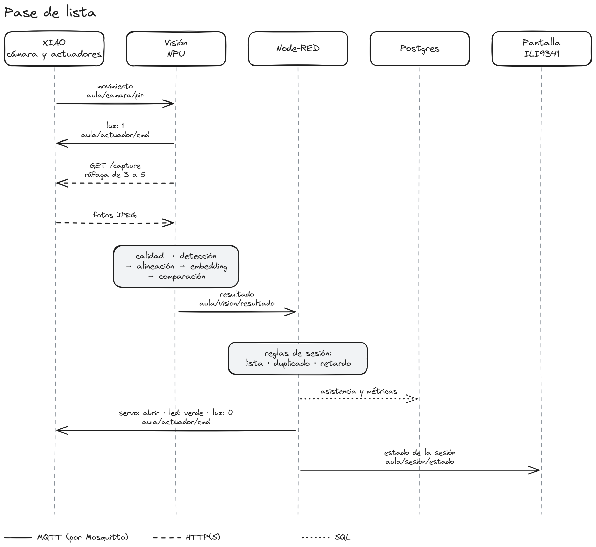
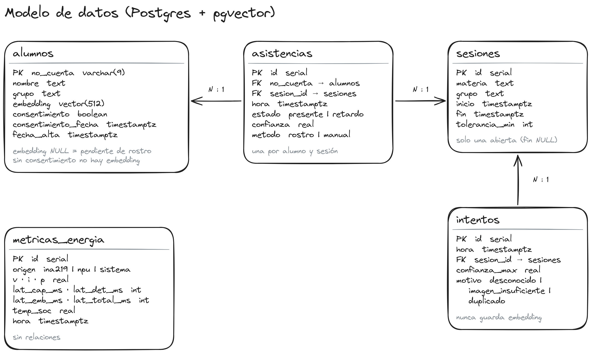

# Pase de lista con reconocimiento facial en Edge AI

**Materia:** Fundamentos de Sistemas Embebidos 2027-1
**Profesor:** Eduardo Fragoso Navarro
**Equipo:** Gustavo · Yordi · Arnau
**Plataforma Edge AI:** Orange Pi Zero 3W (Allwinner A733, NPU de 3 TOPS, 4 GB de RAM)

> Documento vivo. Si una decisión cambia, actualízala aquí.

---

## 1. Problema y objetivo

El pase de lista manual consume tiempo de clase y es propenso a errores. El proyecto previo del equipo ([pase de lista por Bluetooth con Arduino Nano](https://github.com/Yordi-JA/Pase-de-Asitencia-Bluetooth-Proyecto-Final-Sistemas-de-comunicaciones)) automatizó el registro, pero no verificaba la identidad: la app permitía enviar cualquier número de cuenta, así que un alumno podía registrar a otro desde dentro del salón.

**Objetivo:** automatizar el pase de lista verificando la presencia física de cada alumno mediante reconocimiento facial ejecutado localmente en la NPU de la Orange Pi. El sistema registra presente o retardo, da retroalimentación física (puerta simulada con servo), almacena y visualiza los datos, y genera reportes sin depender de servicios en la nube.

## 2. Alcance

**Incluye**
- Reconocimiento facial en la NPU: detección, alineación y embedding.
- Registro de alumnos (enrolamiento) desde un frontend web, con la ILI9341 guiando al alumno frente a la cámara. La pantalla tiene tres vistas: sesión, lista y guía de registro.
- Importación de la lista maestra desde CSV.
- Sesiones de clase con tolerancia de retardo.
- Reglas heredadas del proyecto previo: lista maestra y anti-doble registro.
- Retroalimentación física: servo como puerta simulada, LEDs RGB y buzzer.
- Etapa de potencia: MOSFET que enciende una tira LED de 12 V para iluminar la cara.
- Almacenamiento en Postgres, visualización en la pestaña de métricas del frontend y en la ILI9341.
- Flujo inverso desde la pantalla: la vista de Sesión de la ILI9341 tiene los botones táctiles "Abrir puerta" y "Probar luz LED", que publican por MQTT hacia la XIAO.
- Mejora de imagen para la cámara.
- Medición de consumo energético.

**Opcional**
- Detección de rostro en la propia XIAO ESP32S3 (cascada con la NPU).
- Detección de vida (antispoofing).

**Fuera de alcance**
- Cerradura física real.
- Integración con sistemas escolares.
- Bluetooth.
- App móvil.

## 3. Trazabilidad con los requisitos del documento

| Requisito | Cómo se cumple |
|---|---|
| 1–2. Campo de aplicación con los elementos de la Fig. 1 | Pase de lista verificable en el aula |
| 3. La ESP32 lee los sensores y los envía a la Orange Pi | La XIAO ESP32S3 lee cámara, PIR e INA219 y los envía por HTTP y MQTT; además maneja los actuadores |
| 4. Docker: Mosquitto, Node-RED y base de datos en la Orange Pi | Todo el stack vive en `orangepi/docker-compose.yml`: Mosquitto, Node-RED, Postgres con pgvector y Portainer. Las *Notas* del PDF permiten instalar todos los contenedores en la Orange Pi; Grafana no es obligatorio (las gráficas están en el frontend) e InfluxDB se sustituye por la tabla `metricas_energia` de Postgres, un desvío consciente de los puntos 4 y 5 |
| 5. Node-RED redistribuye a la base de datos, con un nodo que ejecuta el Python de la pantalla | Flujos de ingesta y pase de lista hacia Postgres; un nodo `exec` que ejecuta el programa de Python del reporte CSV, y el reinicio de la pantalla por MQTT |
| 6. Programa de Python para la ILI9341 con menú | `orangepi/pantalla/`, complementado con el frontend web de registro (`web/`), que corresponde a la opción "HTML" de la Fig. 1 |
| 7. Base de datos del sistema | Postgres con pgvector en la Orange Pi y las gráficas en la pestaña de métricas del frontend (nota de la fila 4) |
| Nota: flujo inverso hasta el actuador, con etapa de potencia | Pantalla → MQTT → XIAO ESP32S3 → servo, LEDs y MOSFET con tira LED de 12 V; la pantalla tiene los botones táctiles "Abrir puerta" y "Probar luz LED", y el control completo también está en el frontend web |
| Entregables: reporte con costo y consumo | Experimentos E5 y análisis de costo (sección 10) |

## 4. Arquitectura


Los diagramas de este documento están en `diagramas/`.

| Capa | Dispositivo | Responsabilidad |
|---|---|---|
| Campo | XIAO ESP32S3 | Fotos bajo demanda (HTTP); PIR e INA219 (MQTT); servo, LEDs RGB, buzzer y MOSFET de la tira LED de 12 V (MQTT) |
| Edge | Orange Pi Zero 3W | Servicio de visión (NPU, systemd), Docker (Mosquitto, Node-RED, Postgres con pgvector y Portainer), pantalla ILI9341, frontend web (servido por Node-RED) |
| Administración | Navegador de la laptop del profesor | Frontend web de registro de alumnos; la laptop solo abre el navegador |

**Protocolos:**
- **HTTP:** imágenes de la cámara.
- **MQTT:** telemetría, resultados y comandos.
- **MQTT (puerto 1883, TCP):** el frontend no habla MQTT; no hay listener WebSocket. El progreso del registro le llega por sondeo de la API HTTP de Node-RED (`GET /api/enrolamiento/estado`, cada ~1 s mientras hay un registro abierto; sección 6.7).
- **HTTPS (Node-RED, certificado autofirmado):** frontend estático, API de alumnos y registro, y la galería que pide el servicio de visión (`GET /api/galeria`).
- **SQL por la red del compose:** de Node-RED a Postgres, por el nombre de servicio `postgres`. El puerto 5432 solo se publica en 127.0.0.1.

## 5. Flujos

### 5.1 Pase de lista (flujo directo)



1. El PIR de la XIAO detecta movimiento y lo publica.
2. El servicio de visión enciende la tira LED, espera unos 300 ms a que la exposición se estabilice y pide una ráfaga de fotos en alta resolución.
3. Filtro de calidad: elige la foto más nítida (varianza del Laplaciano). Si ninguna pasa el umbral, publica `motivo: imagen_insuficiente`.
4. En la NPU, detecta el rostro y sus 5 puntos clave, alinea la cara a 112×112 y calcula el embedding.
5. Compara contra la galería local por similitud coseno y publica el resultado con sus latencias.
6. Node-RED aplica las reglas de la sesión:
   - el alumno está en la lista del grupo de la sesión abierta y tiene consentimiento y rostro vigentes en la base (así, un rostro retirado cuya `baja` la visión aún no procesó no marca asistencia);
   - no está ya registrado en la sesión;
   - se clasifica como presente o retardo según la tolerancia, con el reloj de la base: presente si `now()` ≤ `inicio` + `tol_min` minutos.

   Node-RED solo registra los resultados de `modo: "pase"` y descarta los de más de 60 s de antigüedad (o de adelanto) respecto de su reloj. Sin sesión abierta no registra ni manda retroalimentación.
7. Node-RED guarda en Postgres y manda la retroalimentación:
   - **verde:** registrado (presente o retardo), el servo abre y un pitido corto: `{"servo":"abrir","led":"verde","buzzer":1}`;
   - **rojo:** desconocido, ya registrado o reconocido pero de otro grupo o sin rostro vigente, con doble pitido: `{"led":"rojo","buzzer":2}`;
   - **ámbar:** zona gris de confianza o imagen insuficiente: `{"led":"ambar"}`; se repite la captura y, si persiste, el profesor lo marca manualmente desde la pantalla (el marcado manual no está implementado).
   - `sin_rostro` y `error` no mandan retroalimentación: casi siempre fue un disparo del PIR sin nadie enfrente.

   Lo que no se registra como asistencia queda en `intentos` con el motivo `desconocido` (también el reconocido de otro grupo o sin rostro vigente, porque el `CHECK` no admite otro y la tabla no guarda la cuenta), `imagen_insuficiente` o `duplicado`; la zona gris (`dudoso`) no se guarda. El registro es una sola sentencia SQL (una transacción) que toma la sesión abierta de la base, valida el grupo, hace el `INSERT ... ON CONFLICT (no_cuenta, sesion_id) DO NOTHING` y devuelve qué pasó: dos resultados seguidos del mismo alumno dan una sola fila y el segundo recibe rojo, por duplicado.

   El marcado manual es un `INSERT ... ON CONFLICT (no_cuenta, sesion_id) DO NOTHING` con `metodo = 'manual'`. Si no se insertó ninguna fila (el alumno ya estaba registrado en la sesión), Node-RED se lo avisa al profesor. Corregir una asistencia ya registrada solo lo hace el superusuario: el rol de Node-RED no tiene UPDATE ni DELETE sobre `asistencias`.

### 5.2 Control (flujo inverso)

- **Automático:** Node-RED → `aula/actuador/cmd` → XIAO ESP32S3.
- **Manual desde la pantalla:** la vista de Sesión de la ILI9341 tiene los botones táctiles **Abrir puerta** (servo) y **Probar luz LED**, que publican por MQTT hacia la XIAO. Es el flujo inverso de la Fig. 1, de la pantalla hasta el actuador. Desde la misma vista se inicia o termina la sesión.
- **Manual desde el frontend:** el control completo (servo, LEDs y buzzer) está en el frontend web, junto con el registro. La sesión se inicia y se termina solo desde la pantalla, por ahora (sección 5.3).

### 5.3 Sesión de clase

El profesor inicia la sesión con materia, grupo y tolerancia. Node-RED crea el registro en Postgres, en una sola transacción: primero `UPDATE sesiones SET fin = now() WHERE fin IS NULL` (cierra una sesión olvidada) y después el `INSERT` de la nueva. El índice único parcial `sesiones_una_abierta_idx` garantiza que haya a lo más una sesión abierta, incluso si dos inicios llegan a la vez. Después publica `aula/sesion/estado` (retenido, QoS 1); la XIAO enciende el LED azul. Al terminar, se genera el reporte de presentes, retardos y faltas (sección 7.3).

Las órdenes de sesión entran solo por MQTT, por `aula/sesion/cmd`: las publica la pantalla (`iniciar`, con la materia, el grupo y la tolerancia de su configuración, y `terminar`). No hay endpoints HTTP de sesiones ni control de sesión en el frontend por ahora. El registro manual (`marcar`) queda fuera: es solo una propuesta del contrato y Node-RED lo descarta con un aviso. Se descartan también el retain, el payload vacío y el JSON inválido, y un `iniciar` con `materia` o `grupo` que no sean texto no vacío de hasta 40 caracteres sin caracteres de control, o con una `tol_min` que no sea un entero de 0 a 600. Un segundo `iniciar` a menos de 5 s del último aceptado también se descarta (frena un goteo de órdenes y la reentrega duplicada de un QoS 1; la pantalla ya pide doble toque). Si la sesión olvidada que cierra un `iniciar` existía, también se genera su reporte. `terminar` sin sesión abierta no cambia la base, no genera reporte y republica el estado real. Al conectar al broker (arranque, despliegue o reconexión), Node-RED reconcilia `aula/sesion/estado` con la base: publica la sesión abierta o el estado inactivo, de modo que la XIAO y la pantalla ven la verdad aunque el broker haya perdido el retenido.

### 5.4 Registro de alumnos (enrolamiento)

El registro tiene dos partes: primero se da de alta al alumno en la lista maestra y después se le asocia su rostro. Todo se controla desde el frontend web; la captura siempre se hace con la XIAO y el embedding siempre se calcula en la NPU, con el mismo pipeline del pase de lista.

**Parte 1: lista maestra (una vez por grupo).** El profesor sube un CSV (`no_cuenta,nombre,grupo`) desde el frontend. Node-RED lo inserta en `alumnos` con `embedding = NULL`, así que cada alumno queda **pendiente de rostro**.

**Parte 2: registro del rostro.**


> Las flechas continuas son mensajes MQTT por Mosquitto; las discontinuas, HTTP(S), y las punteadas, SQL. Las flechas de Node-RED al frontend son la API HTTP: el frontend no habla MQTT, así que lo que visión publica para él entra por Node-RED y sale por su API (contrato MQTT, sección 2). El progreso en vivo es un sondeo: Node-RED guarda el último estado de `aula/vision/enrolamiento` y el frontend lo consulta con `GET /api/enrolamiento/estado` (sección 6.7).

1. El profesor elige a un alumno pendiente en el frontend y marca el consentimiento, que el alumno firmó antes. Sin consentimiento, el botón de inicio está deshabilitado. La versión del formato de consentimiento es `docs/consentimiento.md`, aún pendiente de redactar.
2. `POST /api/enrolamiento {"cuenta","consentimiento":true}` va detrás de la autenticación de la API (HTTP Basic del profesor, sección 6.7). Node-RED registra el consentimiento con `UPDATE alumnos SET consentimiento = true, consentimiento_fecha = now() WHERE no_cuenta = $1 AND embedding IS NULL`; si no actualiza ninguna fila (la cuenta no existe o ya tiene rostro), rechaza la petición. Si ya hay una inscripción pendiente para esa cuenta (doble clic, segunda pestaña), responde 409 sin tocar nada. Guarda una inscripción pendiente de esa cuenta en el contexto del flujo, que vence tras 5 minutos sin progreso (cada mensaje `aula/vision/enrolamiento` de esa cuenta renueva el plazo), y publica la orden `enrolar`. Así el consentimiento lo escribe solo el profesor, autenticado por HTTP; nada que llegue por MQTT puede darlo.
3. El servicio de visión enciende la tira LED y toma 5 fotos, una por pose: de frente, un poco a la izquierda, un poco a la derecha, un poco hacia arriba y de frente otra vez. La ILI9341 le muestra la pose al alumno, que no ve la laptop del profesor.
4. Cada foto se valida: exactamente un rostro, cara de al menos ~100 px de ancho, nitidez mínima y giro de cabeza moderado. Si se rechaza, el frontend muestra el motivo y se repite esa pose.
5. Se calcula el embedding de cada foto en la NPU. Los que se alejan mucho del resto se descartan; los demás se promedian y se normalizan. El descarte es iterativo: se calcula la media de las poses candidatas, se descarta solo la peor si su coseno con esa media queda por debajo de `min_similitud_pose`, se recalcula la media con las que quedan y se repite. El umbral es **provisional** (0.5) hasta la calibración con LFW (18 de noviembre). El registro es válido si queda un grupo coherente de al menos 3 poses: si al llegar a tres la peor sigue por debajo del umbral, no hay grupo coherente y el registro termina en error con motivo `inconsistente`, sin publicar el embedding. Este descarte **no es un control de vivacidad**: solo exige que 3 de 5 poses sean consistentes entre sí, y el chequeo antifraude del paso 6 sigue siendo necesario. Al calibrar con LFW hay que medir **la misma estadística que usa el código** (el coseno de una pose con la media de las candidatas), no el coseno por pares: para 5 poses con coseno por pares `c`, la métrica del código es `sqrt((1+4c)/5)`, de modo que el umbral 0.5 equivale a un coseno por pares de 0.0625.
6. **Chequeo antifraude:** si el nuevo embedding se parece mucho al de otro alumno ya registrado, el frontend muestra una advertencia informativa. El embedding se guarda igual (no hay paso de confirmación); si el profesor no está de acuerdo, aplica la baja del rostro (`DELETE /api/alumnos/:cuenta/rostro`) y repite el registro.
7. Node-RED recibe `aula/vision/embedding` y solo acepta la `cuenta` de la inscripción abierta (y un `ts` no anterior a su inicio, con 2 s de margen), con `dim` 512, 512 números, `modelo` y norma L2 igual a 1 (tolerancia de 0.01). Guarda el embedding con `UPDATE alumnos SET embedding = $1::vector WHERE no_cuenta = $2 AND consentimiento AND embedding IS NULL` (es el único que escribe en la base). Si no actualiza ninguna fila, lo rechaza (el registro termina en error y se revierte el consentimiento) sin registrar la `cuenta` ni el contenido. Después **cierra la inscripción como `completado`** (la cierra el embedding guardado, no el mensaje `completado` de la visión, que llega antes y por otro tópico) y publica `aula/vision/galeria/alta {"cuenta":...}`; si el embedding se guardó cuando el registro ya estaba cerrado (cancelación, error o vencimiento con el embedding en vuelo), no se da de alta: retira el rostro y el consentimiento y publica `aula/vision/galeria/baja`; el servicio de visión recarga entonces la galería con `GET /api/galeria`. Las fotos se descartan: las miniaturas solo pasan por el navegador y el embedding nunca llega al frontend.
8. **Prueba inmediata:** el alumno se para frente a la cámara y el frontend muestra el resultado y la confianza.
9. **Cancelar o expirar:** `POST /api/enrolamiento/cancelar`, o el vencimiento (5 minutos sin progreso), cierra la inscripción: queda con su estado (`cancelado` o `error`) para que el frontend vea cómo terminó, y ya no acepta mensajes. Al vencer, Node-RED publica `cancelar` a la visión. Si no se guardó ningún embedding, restablece `consentimiento = false, consentimiento_fecha = NULL` (con `AND embedding IS NULL`).
10. **Reinicio o despliegue de Node-RED:** las inscripciones pendientes viven en memoria y no sobreviven un reinicio. Al arrancar el proceso o al desplegar flujos, el mismo manejador primero borra todas las inscripciones pendientes del contexto y después ejecuta `UPDATE alumnos SET consentimiento = false, consentimiento_fecha = NULL WHERE consentimiento AND embedding IS NULL`, para no dejar consentimientos sin rostro. No se borran los retiros de rostros tardíos pendientes (sección 6.7), que viven en un almacén de contexto persistente.

**Reglas del registro:**
- **Mismo pipeline siempre.** El embedding del registro se calcula con el mismo modelo cuantizado en la NPU que el pase de lista. Registrar con el modelo flotante en la PC baja la precisión.
- **Misma cámara.** No se registra con la webcam de la laptop: registrarse con una cámara y reconocerse con otra también baja la precisión.
- **Pase de lista en pausa.** Mientras hay un registro en curso, el servicio de visión ignora el PIR.
- **Re-registro y baja** desde el frontend. Retirar el consentimiento es el inverso del registro: Node-RED hace `UPDATE alumnos SET embedding = NULL, consentimiento = false, consentimiento_fecha = NULL WHERE no_cuenta = $1` y publica `aula/vision/galeria/baja` con la cuenta (QoS 1, sin retención), para que el servicio de visión borre esa entrada de su galería en RAM. Si el servicio estaba caído, la baja se aplica al recargar la galería con `GET /api/galeria`. La base lo impone: no puede haber embedding sin consentimiento con fecha. Volver a registrar a alguien con rostro exige primero la baja y un consentimiento nuevo.
- **Sincronización.** El servicio de visión pide la galería completa a Node-RED (`GET /api/galeria`) al arrancar, en cada reconexión MQTT y al recibir `aula/vision/galeria/alta`. La galería solo cambia por orden de Node-RED (`alta` y `baja`).

## 6. Componentes de software

### 6.1 XIAO ESP32S3 (`firmware/xiao`)
- Core Arduino de ESP32 con PubSubClient, en C++.
- **Toolchain (decidido el 4 nov):** `arduino-cli` 1.5.1 en el equipo que compila (nunca en la Orange Pi), con las versiones fijadas: core `esp32:esp32@3.3.12`, PubSubClient 2.8.0 y ArduinoJson 7.4.3, y la placa `XIAO_ESP32S3` con `PSRAM=opi`, `USBMode=hwcdc` y `PartitionScheme=default_8MB` (8 MB de flash y 8 MB de PSRAM OPI; el búfer JPEG de la cámara va en PSRAM, `firmware/xiao/captura.cpp:175`). Los scripts `firmware/xiao/compilar.sh`, `flashear.sh` e `instalar-arduino-cli.sh` son del carril de Gustavo (el firmware de la XIAO) y los usa él para flashear la placa: comprueban esas versiones, compilan en un directorio temporal que se borra después (porque el binario lleva las claves en claro) y solo flashean a un puerto que la CLI identifique como la XIAO. Sigue **sin flashear en la placa** (`firmware/xiao/README.md`).
- **HTTP:** `/capture?res=SVGA` para la foto. La resolución de reconocimiento es SVGA (800×600) por omisión, con tope duro en XGA (1024×768). `res=` es una lista blanca: `HVGA`, `VGA`, `SVGA` y `XGA`; sin `res=` o con cualquier otro valor, incluido uno mayor que XGA, la foto sale en SVGA. `HVGA` (480×320) queda como resolución baja para una vista previa futura. `/stream` (MJPEG en QVGA) queda para la v2: en la primera versión no se usa, porque el driver de cámara comparte un pool de búferes entre la tarea de stream y el manejador de captura (con el stream abierto, una captura concurrente puede fallar y devolver un cuadro viejo) y el servidor HTTP del IDF tiene un presupuesto de 7 sockets, uno por espectador. Estado: decidido el 13 nov; el firmware de esta rama todavía no lo implementa (`firmware/xiao/captura.cpp:173-174` sigue con `fb_count = 2` y QXGA, y la query de `/capture` no se lee, `firmware/xiao/captura.cpp:72`). Falta implementarlo y verificarlo en la placa.
- **La petición va firmada (decidido el 4 nov).** La cámara no se autentica con usuario y contraseña: la XIAO comprueba una firma **HMAC-SHA256** que el servicio de visión manda en tres cabeceras (`X-Captura-TS`, `X-Captura-Nonce` y `X-Captura-HMAC`), sobre la cadena canónica `GET\n/capture\n<ts>\n<nonce>`. El secreto es compartido entre la placa (`firmware/xiao/secrets.h`) y el borde (`/etc/pase-lista/vision.env`). La XIAO no tiene reloj confiable (el RTC está en la Orange Pi), así que **no compara el `ts` con su hora**: comprueba que no sea más antiguo que el último `ts` que aceptó (ventana de 300 s) y recuerda los 64 últimos nonces para rechazar reenvíos. El HMAC autentica al emisor, **no cifra**: las fotos siguen viajando en claro por la LAN. **OJO:** el cliente que firma la petición (el servicio de visión) todavía **no** está en el repo: vive en su propia rama, porque la parte de la NPU sigue aparte. Hasta que se integre, la placa exige la firma y el servicio no la manda: `/capture` responde 401 y no hay fotos hasta que se junten.
- El driver de cámara **viene con el core de Espressif** (el componente `espressif__esp32-camera` está en las librerías precompiladas de `esp32s3-libs`), así que no hay ninguna dependencia externa que pinear. Los pines del modelo `CAMERA_MODEL_XIAO_ESP32S3` están en el propio core (`libraries/ESP32/examples/Camera/CameraWebServer/camera_pins.h`).
- El servidor HTTP de `/capture` va en **su propia tarea de FreeRTOS** (el `httpd` del IDF): la captura no bloquea el lazo del MQTT.
- Descarta los primeros cuadros al despertar la cámara.
- **MQTT:** publica `aula/camara/pir`, `aula/camara/energia` y `aula/camara/estado`.
- **Modo seguro de la cámara (decidido el 13 nov; firmware pendiente y sin verificar en la placa):** usar la antena externa (U.FL) y captura solo bajo demanda: la placa se calienta si transmite video continuo. Para eso:
  - La cámara no se inicializa en `setup()`. Arranca con la primera petición firmada y válida, y se apaga tras 30 s sin peticiones (`T_reposo`). Los primeros cuadros se descartan.
  - Un solo búfer de cuadro, con `CAMERA_GRAB_WHEN_EMPTY`: el sensor entrega un cuadro solo cuando se pide. Hoy el firmware usa `fb_count = 2` con `CAMERA_GRAB_LATEST` (`firmware/xiao/captura.cpp:173-174`), que es captura continua.
  - Límite de ritmo: como mucho 4 capturas en 2 s. Lo que pase el límite recibe 429 sin tocar la cámara.
  - Vigilancia térmica sobre la lectura interna del ESP32-S3, antes de cada captura y cada 30 s: aviso a 65 °C, corte a 75 °C (503 `temperatura`, con la cámara apagada) y reanudación por debajo de 65 °C.
  - Los 65 °C no son el límite del chip. El ESP32-S3R8 está especificado para una temperatura ambiente de hasta 65 °C, y el sensor interno lee el silicio, que siempre está por encima del ambiente. La temperatura del sensor de imagen no se mide, así que los límites de ritmo y de tiempo encendida son la protección principal, y el corte térmico es la última red.
  - `temp` irá en el latido de `aula/camara/estado` cada 30 s, cuando el firmware lo publique. Si en v1 la XIAO queda fuera de MQTT (pendiente de confirmar), ese latido no llega a nadie.

- Suscrito a `aula/actuador/cmd` y `aula/sesion/estado`; publica `aula/actuador/estado`.
- **Servo:** gira 90° (abierto), espera 3 s y regresa.
- **LEDs:** mismos patrones que el proyecto previo.
  - azul: sesión activa;
  - verde: registrado;
  - rojo: error;
  - ámbar: zona gris.
- El servo se mueve sin bloquear (temporizado con `millis()`), para que la espera de 3 s no detenga el servidor HTTP de la cámara.
- La cámara no gasta un canal LEDC: en el ESP32-S3 el XCLK lo genera el periférico LCD_CAM. El servo, el buzzer y los LEDs RGB sí tienen que repartirse los 4 timers LEDC, y cada timer fija la frecuencia de sus dos canales. **Reparto hecho (4 nov):** timer 0 a 50 Hz para el servo (exclusivo), timer 1 a 2 kHz para el buzzer, timers 2 y 3 a 5 kHz para los tres canales del LED RGB.
- **Tira LED de 12 V (`luz`), de Yordi:** el firmware de la tira vive en el mismo sketch de la XIAO, junto al resto del nodo de campo. Aplica el campo `luz` de `aula/actuador/cmd` en D2 (un MOSFET de lado bajo con los canales R, G y B de la tira unidos: blanco encendido o apagado) y publica `aula/actuador/estado`; `servo`, `led` y `buzzer` los aplica el mismo firmware, ya en esta versión. Si pierde el Wi-Fi o el broker, apaga la tira, y la apaga sola a los 360 s del último `luz:1` (cubre con margen el vencimiento de 5 min del registro de 5 poses; la visión hoy publica `luz:1` una sola vez, y si agrega un reenvío periódico el plazo se puede bajar): quien necesite la luz más tiempo debe reenviar `luz:1` antes de 360 s y no asumir que se aplicó, y hay que avisar a Gustavo por la orquestación luz–captura (contrato v0.8). La tira no gasta canal LEDC: es todo o nada.

### 6.2 Servicio de visión (`orangepi/vision`, C++, nativo)
- **Detección (decidido):** RetinaFace del model zoo de Allwinner/Radxa para la A733, con su conversión y post-proceso en C++ ya hechos (R50 a 320×320 en uint8: unos 15.7 ms en la NPU, según Radxa). Pendiente de medir: entrada de 320 o 640 y backbone R50 o Mobilenet0.25. Con la cámara de la XIAO en SVGA (800×600, por omisión), la foto completa tiene la mitad de píxeles por lado que en UXGA, así que el recorte del rostro para el embedding también mide la mitad por lado. La cifra de unos 12 px a 3 m se calculó con UXGA y hay que volver a medirla. La detección se hace en la imagen reducida, y el recorte para el embedding sale de la foto en resolución completa. YOLOv8n-face (5 puntos clave) queda como alternativa detrás de la misma interfaz.
- **Reconocimiento (decidido):** InsightFace `w600k_mbf` (MobileFaceNet), entrada de 112×112 y **embedding de 512 dimensiones** (acordado con Yordi para `vector(512)`).
- **Fallback del reconocimiento:** si `w600k_mbf` cuantizado pierde precisión, se prueba primero la cuantización int16 o mixta del mismo modelo y, si no basta, se cambia a `w600k_r50` (IResNet50, también de 512, así que el esquema no cambia). Criterio: comparar con los pares de LFW el ONNX flotante contra el `.nb` y aplicar el fallback si el FAR/FRR en el umbral elegido empeora de forma apreciable. Cambiar de modelo invalida los embeddings registrados: hay que volver a registrar a todos.
- **Conversión:** ONNX → Pegasus/Acuity → cuantización uint8 con imágenes de calibración → `.nb`. Para la A733 se usa Acuity **v2.0.10.2** (Docker `ubuntu-npu:v2.0.10.2`, `env.sh v3`) y se exporta con `pegasus_export_ovx_nbg.sh <modelo> uint8 a733`. El `.nb` tiene que ser compatible con el driver `vipcore` 1.13.0 y con las librerías VIPLite de la imagen: no actualizar el kernel sin volver a probar con `vpm_run`.
- **Librerías (decidido):** CMake, libmosquitto (MQTT), cpp-httplib (cliente HTTP), nlohmann/json y OpenCV 4.6 de Debian. Corre nativo con systemd, igual que la pantalla. Un solo hilo de trabajo atiende la cola de eventos y la NPU.
- **Galería en RAM:** `std::vector` con los embeddings (unos 80 KB para 40 alumnos), se carga con `GET /api/galeria` al arrancar, en cada reconexión MQTT y al recibir `aula/vision/galeria/alta` (recarga completa: son unas 40 entradas, y así hay un solo camino de carga). Nunca añade una entrada por su cuenta, ni siquiera tras calcular un embedding: la galería sigue a Node-RED. Al recibir `aula/vision/galeria/baja`, borra la entrada de esa cuenta. Ambos tópicos se suscriben con QoS 1. Desde el 11 nov, `GET /api/galeria` exige además el encabezado `X-Galeria-Token` (ver la sección 6.7). Sin base de datos local.
- **Registro:** atiende las órdenes `enrolar`, `cancelar` y `probar`; publica el progreso en `aula/vision/enrolamiento` y el embedding final en `aula/vision/embedding`. Mientras registra, ignora el PIR.
- **Mejora de imagen:** CLAHE y gamma en CPU (OpenCV). Como experimento: Zero-DCE y superresolución del recorte facial en la NPU.
- **Publica:** número de cuenta, confianza y latencias (captura, detección, embedding, total).

### 6.3 Docker en la Orange Pi (`orangepi/docker-compose.yml`)
- Mosquitto, con un solo listener, el 1883 (sin WebSocket: el frontend no habla MQTT), sin acceso anónimo y con un usuario por rol (`xiao`, `vision`, `nodered`, `pantalla` y `simulador`, este último solo para `herramientas/simular_energia.sh`). La ACL (`orangepi/mosquitto/acl`, sección 6 de `docs/contrato-mqtt.md`) hace que solo `nodered` pueda publicar en `aula/vision/galeria/#` y que solo `nodered` pueda leer `aula/vision/embedding`. El broker usa el nombre de usuario como client id (`use_username_as_clientid`).
- Node-RED, servido por HTTPS en el puerto 1880 con certificado autofirmado. El editor está protegido por usuario y contraseña (`adminAuth`).
- Postgres con la imagen `pgvector/pgvector`: sesiones, alumnos, asistencias y la tabla `metricas_energia`. Se publica solo en `127.0.0.1:5432`; Node-RED lo alcanza por la red del compose con el nombre `postgres`. Node-RED usa un rol de base de datos con privilegios mínimos sobre las tablas que usa (sin DELETE ni DDL), no el superusuario.
- Portainer CE (`portainer/portainer-ce`), el bloque que aparece en la Fig. 1: se administra desde el navegador. Solo escucha en `127.0.0.1:9443`; desde otra máquina se entra con un túnel SSH (`ssh -L 9443:localhost:9443 ...`) y `https://localhost:9443`.
- **La pantalla no corre en Docker.** Es el único componente que necesita SPI, GPIO e I²C, así que se ejecuta en el host como unidad systemd (`orangepi/systemd/orangepi-pantalla.service`), con el usuario del servicio en los grupos `spi`, `gpio` e `i2c`. Así los permisos de `/dev/spidev*` y `/dev/i2c-*` los resuelve el host con sus reglas de udev, sin mapear dispositivos al contenedor, y la pantalla sobrevive a un reinicio de Node-RED.
- **El reinicio de la pantalla va por MQTT.** Node-RED publica un mensaje de reinicio y el script de Python hace `sys.exit(0)`; systemd, con `Restart=always`, lo vuelve a levantar. El arranque y la supervisión reales los hace systemd, no Node-RED.

### 6.4 Node-RED (`nodered/flows/flows.json`)
1. **Ingesta:** MQTT → tabla `metricas_energia` de Postgres (energía, latencias y temperatura).
2. **Pase de lista** (pestaña `Pase de lista`; sección 5.1): consume `aula/vision/resultado` (QoS 1), descarta retain, vacío, JSON inválido, campos inválidos y un `ts` a más de 60 s del reloj de Node-RED, solo registra `modo: "pase"` (`prueba` se ignora; su reenvío a `POST /api/enrolamiento/probar` está pendiente), aplica las reglas de la sesión en una sola sentencia de Postgres (`asistencias` o `intentos`), detrás de un límite de entrada de 5 mensajes por segundo (200 ms entre mensajes) que descarta los que lleguen antes y publica la retroalimentación en `aula/actuador/cmd`. Hecho en el repo; la verificación completa en la placa espera a que la visión publique resultados reales. **Pendiente:** la lista y el "último registro" de la pantalla (necesitan un tópico nuevo y un cambio de ACL) y el marcado manual (`marcar`).
3. **Sesiones** (pestaña `Sesiones`; sección 5.3): iniciar (cierra en la misma sentencia, una transacción, una sesión abierta que se haya quedado olvidada), terminar, publicar `aula/sesion/estado` con su reconciliación al conectar y generar el reporte CSV. Hecho en el repo; pendiente de verificar en la placa.
4. **Pantalla:** reinicio por MQTT (el script de Python hace `sys.exit(0)` y systemd lo levanta) y un nodo `exec` que ejecuta el programa de Python que genera el reporte CSV. Con la pantalla, Node-RED habla solo por MQTT. Hecho en el repo; pendiente de verificar en la placa.
   - **Reinicio:** un nodo `inject` "Reiniciar pantalla" en el editor de Node-RED (pestaña `Sesiones`) publica `{"reiniciar":1}` en `aula/pantalla/reinicio` (QoS 1, sin retain). Sin API.
   - **Reporte CSV:** al cerrarse una sesión, Node-RED ejecuta la consulta de la sección 7.3 y escribe las filas en `/data/reportes/.entrada-<id>.json` con un nodo `file`; el nodo `exec` ejecuta `/usr/bin/python3 -I -B /etc/nodered/reporte_csv.py <id>` (sin shell) y el programa (`nodered/reporte_csv.py`, solo biblioteca estándar) lee ese archivo, lo valida y escribe `/data/reportes/sesion-<id>.csv` en el volumen `nodered_data`. El programa no se conecta a Postgres (la imagen no trae un controlador y no se instala ninguno). Al comando solo llega el `id` entero que devolvió la base, validado; ningún dato de MQTT ni de HTTP. Los reportes pasan por una cola (un nodo `delay` en modo de límite de tasa, 1 mensaje cada 2 s, que solo lleva el id) para que nunca haya dos `python3` a la vez, y el servicio `nodered` tiene `pids_limit: 256` en el compose. El CSV es UTF-8 con BOM, separado por comas, con CRLF, y neutraliza la inyección de fórmulas (un valor, o un segmento tras `;` o `,`, que empieza con `=`, `+`, `-`, `@`, tabulador, retorno de carro, sus formas de ancho completo o el signo menos U+2212 lleva una comilla simple delante). El programa borra siempre la entrada con los nombres, también si falla, y no reintenta. Todavía no hay endpoint de descarga: queda pendiente (ver `orangepi/README.md`, sección Reportes CSV).
5. **Métricas del sistema:** temperatura del SoC, CPU y RAM → Postgres.
6. **Registro:** importación de la lista maestra; `POST /api/enrolamiento`, que registra el consentimiento del profesor, abre la inscripción pendiente (vence tras 5 min sin progreso; 409 si ya hay una) y publica la orden `enrolar`; la limpieza al arrancar o desplegar (borra las inscripciones pendientes y luego los consentimientos sin rostro); el manejador de `aula/vision/embedding`, que solo acepta la cuenta pendiente y guarda el embedding si hay consentimiento y aún no tiene rostro; y la publicación de `aula/vision/galeria/alta` (tras guardar) y `aula/vision/galeria/baja` (al retirar el consentimiento).
7. **API HTTP y frontend:** endpoints del frontend (ver frontend web) y archivos estáticos de `web/`. El frontend se compila dentro de la imagen de Node-RED (`nodered/Dockerfile`) y se sirve en `/app/` con `httpStatic`, con cabeceras de seguridad. Un `httpNodeMiddleware` propio (`nodered/autenticacion-api.js`) protege `/api` (sección 6.7); los estáticos son públicos porque no llevan secretos. Los comandos del frontend al actuador pasan por la API, y Node-RED los publica en `aula/actuador/cmd`. Las sesiones, por ahora, no tienen endpoints: las inicia y termina la pantalla por MQTT (sección 5.3).

**Reglas de los flujos:**
- No se sirve `/api/galeria` sin la autenticación de la API y `GALERIA_TOKEN`: Node-RED no arranca sin sus credenciales (desplegada y verificada en la placa, 2 nov). No se registra a ninguna persona real sin esa autenticación verificada en la placa y sin las ACL de Mosquitto (4 nov); antes de eso, solo identidades de prueba (LFW y miembros del equipo).
- El consentimiento lo escribe solo el endpoint HTTP del profesor. El manejador de `aula/vision/embedding` nunca lo escribe: solo guarda el embedding de la cuenta pendiente cuando ya hay consentimiento.
- Los embeddings viajan siempre como parámetros enlazados (`$1::vector`), nunca concatenados en el SQL. Los nodos catch y debug de las rutas de embeddings registran solo el código SQLSTATE o un mensaje truncado y sin secuencias de 9 dígitos, nunca el mensaje completo ni sus parámetros.

### 6.5 Pantalla ILI9341 (`orangepi/pantalla`, Python, táctil XPT2046)

- Programa Python ejecutado en el host por systemd. La pantalla y el táctil XPT2046 comparten el bus SPI, con dos líneas CS distintas: el proceso necesita permisos de `spi` y `gpio` (el RTC DS3231 por I²C se descartó porque la Orange Pi cuenta con conexión de red y hora sincronizada por NTP). La pantalla (interfaz y programa Python) la mantiene Yordi, junto con el frontend; el hardware de la pantalla (overlays de SPI y unidad systemd) lo mantiene Arnau.

| Pantalla | Contenido |
|---|---|
| Sesión | Sesión activa, último registro (nombre y estado), contador de presentes; iniciar o terminar, materia, grupo y tolerancia; botones táctiles "Abrir puerta" (servo) y "Probar luz LED" |
| Lista | Presentes, retardos y faltantes |
| Guía de registro | Se activa sola durante un registro: nombre del alumno, pose a adoptar y progreso (3/5). El registro se controla desde el frontend |

La pantalla conserva los botones "Abrir puerta" y "Probar luz LED" porque el PDF exige el flujo inverso, de la pantalla hasta el actuador. El control completo del servo, los LEDs y el buzzer vive además en el frontend web, que ya tiene la sesión y el registro. Las vistas de imagen y de sistema quedan fuera de la pantalla: esa información vive en la pestaña de métricas del frontend.

Estado (6 nov): el menú base con las tres vistas, el táctil XPT2046 calibrado y el cliente MQTT están validados en la placa con la pantalla física conectada (`orangepi/pantalla/README.md`). El 6 nov se validó punto a punto con inferencia NPU y pase de lista real ([`docs/RESULTADOS-PRUEBAS.md`](RESULTADOS-PRUEBAS.md)): la pantalla reflejó el estado del alumno enrolado en verde, desplegó el aviso de bienvenida con estatus `retardo` al identificarlo, incrementó el contador de presentes en vivo, y el botón táctil "Terminar sesión" concluyó la sesión y generó `sesion-20.csv`. Falta únicamente la prueba bajo systemd y verificar la interacción de actuadores ("Abrir puerta" y "Probar luz LED") con la XIAO física en campo.

### 6.6 Almacenamiento y gráficas (en la Orange Pi)
- Postgres con la imagen `pgvector/pgvector`: alumnos, sesiones, asistencias e intentos, más la tabla `metricas_energia` con las lecturas del INA219, las latencias y la temperatura del SoC.
- Los promedios del reporte salen de consultas SQL sobre esa tabla.
- **Las gráficas están en el frontend**, en la tercera pestaña, "Métricas y Asistencia", que consume la API de Node-RED:
  - asistencia por sesión;
  - latencia de inferencia;
  - potencia;
  - confianza.
- La laptop del profesor solo abre el navegador: no corre ningún contenedor.

### 6.7 Frontend web de registro (`web/`, Vite + React + TypeScript)
- Lo usa el profesor desde el navegador de su laptop, en la misma red. Se compila dentro de la imagen de Node-RED, que lo sirve en `/app/` desde la Orange Pi (`httpStatic`).
- **Todo por la API HTTP de Node-RED, sin MQTT en el navegador** (decisión de Yordi: no hay listener WebSocket ni usuario MQTT para el frontend). Los comandos al actuador pasan por la API, y Node-RED los publica en MQTT; las sesiones, por ahora, no tienen endpoints (las inicia la pantalla por MQTT, sección 5.3). El progreso en vivo del registro es un **sondeo** (decisión de Yordi): Node-RED guarda el último estado de `aula/vision/enrolamiento` en la inscripción abierta y el frontend consulta `GET /api/enrolamiento/estado` cada ~1 s mientras haya un registro abierto, con pausa si la pestaña está oculta.
- Sin vista previa en vivo en la primera versión: el servidor de cámara de la ESP32 maneja mal un stream abierto mientras recibe capturas. La retroalimentación de cada foto es su estado, su motivo y su miniatura (la del contrato MQTT, que ya tiene transporte: la emite el servicio de visión con la pose y Node-RED la sirve al navegador mientras el registro está abierto). El endpoint `/stream` existe, pero la v1 no lo usa.

| Vista | Contenido |
|---|---|
| Alumnos | Lista por grupo con estado (pendiente o registrado), búsqueda por nombre o cuenta, ir a Registro con el alumno elegido y retirar el rostro (con confirmación); importación del CSV de la lista maestra. Volver a registrar a quien tiene rostro exige retirarlo antes |
| Registro | Elegir al alumno, consentimiento, iniciar o cancelar, las 5 poses con su estado y motivo, advertencia de parecido y resultado; el progreso se retoma al recargar la página. Pendientes: prueba inmediata y control manual del servo, los LEDs y el buzzer |
| Métricas y Asistencia | Asistencia por sesión, latencia de inferencia, potencia y confianza, con los datos de la API de Node-RED |

La importación del CSV de la lista maestra se hace desde la vista de Alumnos, con un `<input type="file" accept=".csv">` que sube el archivo a `POST /api/alumnos/importar` como cuerpo crudo (`Content-Type: text/csv; charset=utf-8`). El profesor la ejecuta una vez por grupo.

**Endpoints (Node-RED, protegidos por el `httpNodeMiddleware` de `settings.js`):**

```
GET    /api/alumnos?grupo=          lista con estado de rostro
POST   /api/alumnos/importar        CSV de la lista maestra
GET    /api/sesiones?limite=        historial de sesiones con conteos, confianza e intentos
GET    /api/sesiones/:id            detalle nominal de asistencia e intentos rechazados de la sesión
GET    /api/sesiones/:id/csv        descarga de /data/reportes/sesion-<id>.csv (solo lectura)
GET    /api/metricas/energia        lecturas recientes de voltaje, corriente y potencia
POST   /api/enrolamiento            {"cuenta":"320068234","consentimiento":true}
POST   /api/enrolamiento/cancelar
GET    /api/enrolamiento/estado     progreso del registro (sondeo del frontend)
POST   /api/enrolamiento/probar     reconocimiento de prueba (pendiente)
DELETE /api/alumnos/:cuenta/rostro  retira el consentimiento: embedding NULL en la base y aula/vision/galeria/baja
GET    /api/galeria                 embeddings para el servicio de visión (no lo usa el frontend); exige X-Galeria-Token
```

`POST /api/enrolamiento` registra el consentimiento del profesor y abre la inscripción pendiente; `POST /api/enrolamiento/cancelar` la cierra; el embedding se guarda cuando llega por MQTT (sección 5.4). `DELETE /api/alumnos/:cuenta/rostro` es el retiro del consentimiento, con la baja por MQTT de la sección 7.1.

**Contrato del registro y del retiro del rostro** (implementados en `nodered/flows/flows.json`, pestaña "Registro"; `POST /api/enrolamiento/probar` sigue pendiente). Los cuatro exigen la autenticación de la API; los que cambian datos, además `X-Pase-Lista: 1` y el mismo origen (403 si falta). Todo error lleva `{"error":"..."}`, y un 500 de la base, `{"error":"No se pudo completar la operación en la base de datos"}`.

- `POST /api/enrolamiento` con `Content-Type: application/json` y `{"cuenta":"320068234","consentimiento":true}` (otro tipo, 415). **202** `{"cuenta","nombre","abierto":true}`: escribió `consentimiento = true` y `consentimiento_fecha = now()`, abrió la inscripción y publicó `aula/vision/cmd {"accion":"enrolar","cuenta","nombre"}`. **400** si el cuerpo no es un objeto, `cuenta` no es un texto de 9 dígitos o `consentimiento` no es el booleano `true`. **404** si la cuenta no existe. **409** si ya hay un registro abierto (`"motivo":"registro_abierto"`, sea de esa cuenta o de otra, sin tocar nada) o si el alumno ya tiene rostro (`"motivo":"tiene_rostro"`): **re-registrar exige retirar antes el rostro** (`DELETE`) y un consentimiento nuevo, y el embedding anterior no se pisa nunca; un 409 con `"motivo":"interrumpido"` indica que el registro se canceló mientras se escribía el consentimiento. El lugar de la inscripción se aparta antes de escribir en la base, así que dos peticiones a la vez (doble clic) no pasan las dos.
- `POST /api/enrolamiento/cancelar`, sin cuerpo. **200** `{"cancelado":true,"abierto":false}`: cerró la inscripción, publicó `aula/vision/cmd {"accion":"cancelar","cuenta"}` y revirtió el consentimiento (`consentimiento = false` y fecha `NULL`, con `AND embedding IS NULL`). Sin registro abierto responde **200** `{"cancelado":false,"abierto":false}` y no publica nada: es idempotente, porque lo que la persona quiere (que no haya registro abierto) ya se cumple, y un 409 haría fallar al frontend cuando el registro terminó justo antes de pulsar "Cancelar".
- `GET /api/enrolamiento/estado`: solo lectura. **200** `{"abierto","cuenta","nombre","estado","motivo","poses":[{"pose","estado","motivo","miniatura"}],"advertencia","inicio","actualizado"}`. `abierto` es `true` mientras el registro espera, captura o guarda. `estado` es uno de `sin_registro` (ninguno desde que arrancó Node-RED: `cuenta`, `nombre`, `inicio` y `actualizado` van `null` y `poses` va vacío), `esperando_vision` (se ordenó enrolar y la visión aún no ha publicado nada), `en_curso`, `guardando` (la visión aceptó las 5 poses y falta recibir y guardar el embedding), `completado`, `cancelado` y `error`. `motivo` va `null` salvo en `error`: `ocupado`, `inconsistente`, `npu`, `cuenta_invalida` (del contrato MQTT), `vencido` (5 minutos sin progreso), `no_guardado` (la base no guardó el embedding), `embedding_invalido` (la visión mandó un `dim` distinto de 512, un arreglo inválido o un vector cuya norma L2 no es 1) o `desconocido`. `poses` siempre trae las 5 (`frente`, `izquierda`, `derecha`, `arriba`, `frente_2`) con `estado` en `pendiente`, `esperando_pose`, `capturando`, `aceptada` o `rechazada`, y `motivo` solo en `rechazada` (`sin_rostro`, `varios_rostros`, `rostro_chico`, `borrosa`, `giro_excesivo`, `fallo_captura`). `advertencia` es `null` o `{"parecido_a":"<cuenta>"|null}`. `inicio` y `actualizado` son fechas ISO 8601 en UTC. Tras cerrarse, el último registro sigue visible (con `abierto: false`) hasta que empiece otro o Node-RED se reinicie, para que el frontend vea cómo terminó. **Nunca incluye embeddings**: copia solo estos campos. La miniatura de cada pose (`poses[].miniatura`) sí se incluye, pero es efímera: solo sale mientras el registro está abierto, no se guarda en la base de datos ni en ningún archivo y al cerrarse el registro se borra.
- `DELETE /api/alumnos/:cuenta/rostro`, sin cuerpo. **400** si la cuenta de la ruta no tiene 9 dígitos, **404** si no existe, **409** `"motivo":"registro_abierto"` si hay un registro abierto de esa cuenta (se cancela antes). **200** `{"cuenta","rostro":"pendiente","retirado":true|false}`: una sola sentencia deja `embedding = NULL`, `consentimiento = false` y `consentimiento_fecha = NULL`. Es idempotente: si el alumno ya estaba pendiente responde 200 con `"retirado":false` y no publica nada; si tenía rostro (`"retirado":true`), publica `aula/vision/galeria/baja {"cuenta"}` (QoS 1, sin retención) después de escribir en la base.

**Cómo avanza el registro en Node-RED.** La inscripción abierta vive en el contexto del flujo (memoria): cuenta, nombre, estado, las 5 poses, la advertencia y los instantes de inicio y última actualización. `aula/vision/enrolamiento` solo la actualiza si su `cuenta` es la de la inscripción abierta y su `ts` no es anterior al inicio del registro (con 2 s de margen; así un `cancelado` o un embedding de una sesión anterior de la misma cuenta no afecta al registro nuevo); descarta lo retenido, lo vacío, lo de otra cuenta y lo que no trae `ts` legible. **`completado` no cierra la inscripción**: la visión lo publica antes que el embedding y por otro tópico y otra QoS, sin garantía de orden, así que cerrarla ahí haría rechazar el embedding y perdería el registro. La cierra el embedding guardado (`completado`), `cancelado` o `error` de la visión (con reversión del consentimiento), la cancelación del profesor o el vencimiento de 5 minutos sin progreso (20 ticks de un temporizador de 15 s, no el reloj de pared, que puede saltar: `error` con `vencido`, orden `cancelar` a la visión y reversión). `aula/vision/embedding` se guarda solo si coincide con la inscripción abierta, trae `dim` 512 y 512 números y un `modelo`, y la base confirma `consentimiento` y rostro vacío; después se publica `galeria/alta`. Un mensaje de la cuenta abierta que no sirve cierra el registro como `error` (`embedding_invalido`) y revierte el consentimiento. Si el embedding se guardó cuando el registro ya estaba cerrado (cancelado, error o vencido con el embedding en vuelo), no se da de alta: se retira el rostro y el consentimiento y se publica `galeria/baja` (esa cuenta no tenía rostro antes, o el registro no se habría abierto); el estado de la API sigue diciendo cancelado, error o vencido. El retiro está atado al consentimiento bajo el que se guardó ese embedding: el `UPDATE` del embedding devuelve `consentimiento_fecha` y el retiro solo actúa si la fila sigue con esa fecha, de modo que no puede borrar el rostro de un registro posterior de la misma cuenta, y se publica `galeria/baja` si el retiro actuó o `galeria/alta` si no (ya estaba retirado, o hay otro consentimiento): cualquier alta hace recargar la galería a la visión y la deja igual que la base. Si el retiro falla, el par cuenta/fecha queda en `retiros_pendientes`, un almacén de contexto `localfilesystem` (`/data/context`, `contextStorage` en `settings.js`; el resto del contexto sigue en memoria), y se reintenta cada 15 s, también después de reiniciar Node-RED. Al arrancar o desplegar los flujos se borra la inscripción y se quitan los consentimientos sin rostro (sección 5.4, paso 10), con un reintento cada 15 s si el `UPDATE` falla y no hay un registro abierto. **No se debe desplegar Node-RED con un registro abierto**: al arrancar, el registro se cierra y se pierde.

**Autenticación de la API (desplegada y verificada en la placa, 2 nov).** No se usa `httpNodeAuth`, que es global y bloquearía al servicio de visión: `nodered/settings.js` instala un `httpNodeMiddleware` propio (`nodered/autenticacion-api.js`) que se aplica antes de cualquier ruta `http in`:

- **Todo `/api/*` exige HTTP Basic** con un único usuario de profesor (`NODERED_PROFESOR_USER` y `NODERED_PROFESOR_PASSWORD`), comparado en tiempo constante. Sin credenciales o con credenciales erróneas, 401 con `WWW-Authenticate: Basic`. El frontend, que es del mismo origen, usa el diálogo nativo del navegador: no hay pantalla de inicio de sesión propia.
- **Excepción: `GET /api/galeria` no usa Basic.** Solo acepta el encabezado `X-Galeria-Token` igual a `GALERIA_TOKEN`, comparado en tiempo constante. Ese token solo lo tienen Node-RED y el servicio de visión, nunca el navegador: las credenciales del profesor no bastan para descargar embeddings. Con token ausente o erróneo, 401 sin `WWW-Authenticate: Basic`.
- **Falla cerrado:** si falta `NODERED_PROFESOR_USER`, `NODERED_PROFESOR_PASSWORD` o `GALERIA_TOKEN`, `settings.js` lanza una excepción y Node-RED no arranca (como con `NODERED_ADMIN_*`); Compose tampoco levanta el stack.
- **Contra CSRF**, todo método que no sea `GET` ni `HEAD`, ya autenticado, exige la cabecera propia `X-Pase-Lista: 1` y se rechaza (403) si llega `Origin` o `Sec-Fetch-Site` de otro origen: el navegador reenvía el Basic guardado aunque la petición la dispare otro sitio, pero ese sitio no puede añadir la cabecera sin un preflight CORS. Cada `fetch` del frontend que cambie datos debe mandarla; los `GET` (incluidos los del frontend actual y los de la visión) no la necesitan, y por eso **ningún `http in` GET o HEAD puede cambiar datos ni publicar en MQTT** (lo comprueba `nodered/pruebas/get-solo-lectura.test.js`).
- **Secretos:** Node-RED no arranca si `NODERED_PROFESOR_PASSWORD`, `GALERIA_TOKEN` o `NODERED_ADMIN_PASSWORD` valen `cambiar_esta_clave` o si dos de esos tres son iguales, ni si `GALERIA_TOKEN` tiene menos de 32 caracteres o `NODERED_PROFESOR_PASSWORD` menos de 16, ni si alguna de esas dos tiene menos de 8 caracteres distintos. Un valor que contenga `cambiar_esta_clave` se rechaza.
- Los estáticos de `/app/` siguen públicos y el editor conserva su `adminAuth`.
- Todas las peticiones de la API pasan por un tope de cuerpo de 256 KiB (413 si `Content-Length` lo supera, 411 si no trae `Content-Length`) y se responden sin caché.

**Contrato de los endpoints de alumnos y galería** (los tres están implementados en `nodered/flows/flows.json`, pestaña "Alumnos"):

- `GET /api/alumnos?grupo=`: arreglo `[{"cuenta":"320068234","nombre":"...","grupo":"...","rostro":"pendiente"|"registrado"}]`, ordenado por grupo y nombre. `grupo` es opcional (1 a 40 caracteres, sin caracteres de control); inválido, 400 con `{"error":"..."}`. Nunca incluye embeddings: la consulta ni siquiera los selecciona.
- `POST /api/alumnos/importar[?existentes=actualizar|omitir]`: el cuerpo es el CSV crudo (`Content-Type: text/csv; charset=utf-8`, obligatorio, otro tipo da 415; no multipart; con `X-Pase-Lista: 1`), con encabezado `no_cuenta,nombre,grupo`, de a lo más 500 filas y 256 KiB. Se valida el archivo completo antes de escribir (cuenta de 9 dígitos, nombre de hasta 120 caracteres y grupo de hasta 40, ambos no vacíos, cuentas repetidas, comillas, BOM, UTF-8). Respuestas: **400** `{"error","total_errores","filas":[{"fila":3,"error":"..."}]}` (la fila es la línea del archivo, con el encabezado en la 1; se listan hasta 100) y no se importa nada; **409** si alguna cuenta ya existe y no se indicó `existentes`: `{"escrito":false,"error","existentes":[{"cuenta","actual":{"nombre","grupo"},"csv":{"nombre","grupo"},"cambia","tiene_rostro"}],"opciones":["actualizar","omitir"]}` y no se importa nada, porque la decisión es del profesor (hay un segundo 409, `{"escrito":true,"error","insertadas","actualizadas","omitidas","total"}`, sin `existentes`: otra importación simultánea ganó la carrera por una cuenta del archivo, y las filas nuevas ya se escribieron; reenviar con `existentes` es seguro); **200** `{"insertadas","actualizadas","omitidas","total"}`; **413** si el cuerpo pesa más de 256 KiB; **415** si el `Content-Type` no es `text/csv`; **403** si falta `X-Pase-Lista: 1` o la petición es de otro origen. `actualizar` cambia solo `nombre` y `grupo` de las existentes e inserta las nuevas; `omitir` inserta solo las nuevas; otro valor de `existentes`, 400. Nunca toca `embedding`, `consentimiento` ni `consentimiento_fecha`, y nunca borra: una sola sentencia SQL (una sola transacción) con el rol de Node-RED.
- `GET /api/galeria` (solo con `X-Galeria-Token`): `{"embeddings":[{"cuenta":"320068234","embedding":[...512 números...]}]}` con los alumnos que tienen `consentimiento` y `embedding` no nulo, ordenados por cuenta; sin ninguno, `{"embeddings":[]}`. Es el formato que lee `orangepi/vision/src/gallery_store.cpp` (la primera de las formas que acepta).

## 7. Datos

### 7.1 Tópicos MQTT


```
aula/camara/pir          XIAO → visión           {"mov":1}
aula/camara/energia      XIAO (y simulador, solo pruebas) → Node-RED          {"v":12.1,"i":0.85,"p":10.3}
aula/camara/estado       XIAO → Node-RED          {"rssi":-58,"heap":120000,"temp":48}   (retenido)
aula/actuador/cmd        Node-RED, pantalla, visión → XIAO          {"servo":"abrir","led":"verde","buzzer":1,"luz":0}   (Node-RED o pantalla)
aula/actuador/estado     XIAO → Node-RED, pantalla          {"servo":"cerrado","led":"azul","luz":0}   (retenido)
aula/vision/resultado    visión → Node-RED       {"ts":"...","modo":"pase","decision":"reconocido","cuenta":"320068234","conf":0.78,"margen":0.21,"lat_ms":{"cap":180,"det":12,"emb":6,"total":240}}
aula/vision/cmd          Node-RED → visión       {"accion":"enrolar","cuenta":"320068234","nombre":"Ana López"}   (enrolar, cancelar, probar)
aula/vision/enrolamiento visión → LCD, Node-RED  {"ts":"...","cuenta":"320068234","paso":3,"total":5,"pose":"izquierda","estado":"rechazada","motivo":"borrosa","miniatura":"<base64>"}
aula/vision/embedding    visión → Node-RED       {"ts":"...","cuenta":"320068234","dim":512,"modelo":"w600k_mbf-uint8-v1","embedding":[...]}   (QoS 1, retain=false; solo lo consume Node-RED, que acepta únicamente la cuenta con inscripción pendiente)
aula/vision/estado       visión (+ LWT) → Node-RED  {"ts":"...","en_linea":true,"modo":"inactivo","galeria":38,"modelo":"w600k_mbf-uint8-v1"}   (retenido; el LWT del broker lleva la forma mínima {"en_linea":false})
aula/vision/galeria/alta Node-RED → visión       {"cuenta":"320068234"}   (QoS 1, nunca retenido; tras guardar el embedding, o para reconciliar tras un retiro tardío sin efecto: el servicio recarga la galería con GET /api/galeria)
aula/vision/galeria/baja Node-RED → visión       {"cuenta":"320068234"}   (QoS 1, nunca retenido; retira a una persona de la galería en RAM)
aula/sesion/cmd          pantalla, Node-RED → Node-RED     {"accion":"iniciar","materia":"FSE","grupo":"1","tol_min":10}
aula/pantalla/reinicio   Node-RED → pantalla     {"reiniciar":1}
aula/sesion/estado       Node-RED → XIAO, pantalla        {"activa":true,"id":12,"materia":"FSE","grupo":"1","inicio":"2026-11-04T15:10:00+00:00","tol_min":10}  |  {"activa":false,"id":12}   (retenido)
aula/sesion/asistencia   Node-RED → pantalla              {"activa":true,"id":12,"presentes":5,"retardos":1,"faltantes":4,"ultimo":{"nombre":"Ana López","estado":"presente"}}  |  {"activa":false}   (retenido)
aula/sistema/metricas    Node-RED → Node-RED    {"ts":"...","temp":52.1,"cpu":34,"ram":61}   (cada 10 s; temperatura, CPU y RAM de la placa)
```

> Los valores de ejemplo son ilustrativos, no mediciones.

> **Payloads de la visión (contrato MQTT v0.3; la forma del estado, v0.4).** El detalle completo está en [`docs/contrato-mqtt.md`](contrato-mqtt.md), que manda sobre este resumen.
> - `aula/vision/resultado` (consumo en Node-RED, contrato v0.11): `ts` es obligatorio y debe estar a menos de 60 s del reloj de Node-RED; solo `modo: "pase"` registra asistencia; la retroalimentación en `aula/actuador/cmd` usa `buzzer` `1` (pitido corto de éxito) y `2` (doble pitido de error). Lleva `ts`, `modo` (`pase` o `prueba`), `decision` (`reconocido`, `dudoso`, `desconocido`, `sin_rostro`, `imagen_insuficiente`, `error`), `cuenta`, `conf`, `margen` y `lat_ms`, con las etapas que no corrieron en `null`. `decision` es el campo que dice qué pasó; `motivo` (opcional) da el detalle fino, porque el esquema SQL `intentos.motivo` lo necesita.
> - `aula/vision/enrolamiento`: el vocabulario de `estado` es `esperando_pose`, `capturando`, `aceptada`, `rechazada`, `advertencia`, `completado`, `cancelado` y `error`; las cinco poses son `frente`, `izquierda`, `derecha`, `arriba` y `frente_2` (la quinta es otra toma de frente, no una repetición de la primera).
> - `aula/vision/embedding`: `dim` y `modelo` son obligatorios. Los códigos `vencido`, `no_guardado`, `embedding_invalido` y `desconocido` que aparecen en `GET /api/enrolamiento/estado` son solo de la API HTTP: no viajan por MQTT (contrato v0.7).
> - `aula/vision/estado` (retenido): lo publica la visión en cada cambio de modo y en la salida ordenada del servicio. El Will del broker lleva la forma mínima `{"en_linea": false}`; el estado final de la salida ordenada lleva el esquema completo.

> Con la ACL (v0.5 del contrato), solo el usuario `nodered` puede publicar en `aula/vision/galeria/#`. El frontend no es un cliente MQTT: recibe estos datos por la API de Node-RED, y sus comandos entran por la API, no por `aula/actuador/cmd` ni `aula/sesion/cmd` directamente.
> Los consumidores de todo tópico con Retain = no en la tabla de la sección 2 del contrato ignoran los mensajes con retain y los de payload vacío, en cualquier tópico y no solo en `*/cmd` (contrato v0.5, sección 1; afecta al firmware de la XIAO y al servicio de visión, incluidos `aula/camara/pir` y `aula/vision/cmd`), porque la ACL no puede impedir el retain por tópico. Node-RED borra los retenidos de los `*/cmd`, `aula/camara/pir`, `aula/camara/energia` y `aula/vision/resultado` en cada conexión al broker, lo que provoca un mensaje vacío en vivo (sin retain) en cada uno de esos tópicos. Node-RED ya descarta retain en `aula/vision/resultado`, `aula/vision/embedding` y `aula/vision/enrolamiento`; los demás tópicos con Retain = no que la limpieza no cubre (`aula/vision/galeria/alta`, `aula/vision/galeria/baja`, `aula/pantalla/reinicio` y `aula/sistema/metricas`) deben descartar retain en el flujo que los consuma; la alternativa, ampliar la lista de la limpieza, está descrita en el contrato.
> **Límites de la XIAO (contrato v0.8, sin cambio de tópicos ni ACL).** La XIAO publica `aula/actuador/estado` y `aula/camara/estado` con QoS 0 por la limitación de PubSubClient; el estado es parcial, `{"luz":N}`, hasta que entren el servo y los LEDs; descarta los mensajes de `aula/actuador/cmd` que llegan en los 1500 ms siguientes a suscribirse (la biblioteca no expone la bandera retain); y apaga la tira sola a los 360 s del último `luz:1` y al perder el enlace con el broker; hasta que entre el firmware de Gustavo, `aula/camara/estado` se publica solo al conectar, sin latido de 30 s ni `rssi`, `heap` ni `temp`. **Afecta al carril de Gustavo (visión):** no asumir que `luz:1` se aplicó y reenviarlo antes de 360 s si hace falta más tiempo.
> **Sesiones (contrato MQTT v0.10, sin cambio de tópicos ni ACL).** `aula/sesion/cmd` lo publica la pantalla y solo lo consume Node-RED; `iniciar` exige `materia` y `grupo` (texto de 1 a 40 caracteres, sin caracteres de control) y `tol_min` (entero de 0 a 600), y `marcar` se descarta. `aula/sesion/estado` (retenido, QoS 1) lleva `{"activa":true,"id","materia","grupo","inicio","tol_min"}` con la sesión abierta y `{"activa":false,"id"}` con la última cerrada (sin `id` si la base no tiene ninguna sesión); `inicio` es ISO 8601 con `+00:00`. Node-RED lo publica después de escribir en la base y lo reconcilia con ella al conectar al broker. `terminar` sin sesión abierta no genera reporte y republica el estado real.
> `aula/sistema/metricas` lo publica Node-RED con el usuario `nodered`, que ya tiene escritura en `aula/#`; el flujo aún no existe (contrato MQTT, sección 5).

### 7.2 Esquema de Postgres (`orangepi/sql/schema.sql`)



```sql
CREATE EXTENSION IF NOT EXISTS vector;

CREATE TABLE alumnos (
  no_cuenta      VARCHAR(9) PRIMARY KEY CHECK (no_cuenta ~ '^[0-9]{9}$'),
  nombre         TEXT        NOT NULL,
  grupo          TEXT        NOT NULL,
  embedding      vector(512),            -- NULL = pendiente de rostro
  consentimiento BOOLEAN     NOT NULL DEFAULT FALSE,
  consentimiento_fecha TIMESTAMPTZ,      -- cuándo el profesor registró el consentimiento; formato: docs/consentimiento.md (pendiente)
  fecha_alta     TIMESTAMPTZ NOT NULL DEFAULT now(),
  CONSTRAINT alumnos_embedding_requiere_consentimiento
    CHECK (embedding IS NULL OR consentimiento),   -- retirar = embedding NULL, consentimiento false y fecha NULL
  CONSTRAINT alumnos_consentimiento_con_fecha
    CHECK (consentimiento = (consentimiento_fecha IS NOT NULL))
);
-- schema.sql añade autovacuum agresivo en alumnos: el embedding borrado no debe
-- quedarse como tupla muerta.

CREATE TABLE sesiones (
  id             SERIAL PRIMARY KEY,
  materia        TEXT        NOT NULL,
  grupo          TEXT        NOT NULL,
  inicio         TIMESTAMPTZ NOT NULL DEFAULT now(),
  fin            TIMESTAMPTZ,
  tolerancia_min INT         NOT NULL DEFAULT 10
);
-- A lo más una sesión abierta a la vez
CREATE UNIQUE INDEX sesiones_una_abierta_idx ON sesiones ((true)) WHERE fin IS NULL;

CREATE TABLE asistencias (
  id        SERIAL PRIMARY KEY,
  no_cuenta VARCHAR(9)  NOT NULL REFERENCES alumnos,
  sesion_id INT         NOT NULL REFERENCES sesiones,
  hora      TIMESTAMPTZ NOT NULL DEFAULT now(),
  estado    TEXT        NOT NULL CHECK (estado IN ('presente','retardo')),
  confianza REAL,
  metodo    TEXT        NOT NULL CHECK (metodo IN ('rostro','manual')),
  UNIQUE (no_cuenta, sesion_id)          -- reemplaza checkIfAlreadyRegistered()
);

CREATE TABLE intentos (
  id            SERIAL PRIMARY KEY,
  hora          TIMESTAMPTZ NOT NULL DEFAULT now(),
  sesion_id     INT REFERENCES sesiones,
  confianza_max REAL,
  motivo        TEXT CHECK (motivo IN ('desconocido','imagen_insuficiente','duplicado'))
  -- sin embedding: quien no se reconoce no dio consentimiento
);

CREATE TABLE metricas_energia (
  id            SERIAL PRIMARY KEY,
  origen        TEXT        NOT NULL,     -- ina219, npu, sistema
  v             REAL,                     -- voltaje del INA219
  i             REAL,                     -- corriente del INA219
  p             REAL,                     -- potencia del INA219
  lat_cap_ms    INT,                      -- latencia de captura
  lat_det_ms    INT,                      -- latencia de detección
  lat_emb_ms    INT,                      -- latencia de embedding
  lat_total_ms  INT,                      -- latencia total de inferencia
  temp_soc      REAL,                     -- temperatura del SoC
  hora          TIMESTAMPTZ NOT NULL DEFAULT now()
);

-- Para GET /api/metricas/energia: filtra por origen y ordena por hora e id
CREATE INDEX IF NOT EXISTS metricas_energia_origen_hora_idx
  ON metricas_energia (origen, hora DESC, id DESC);
```

Zona horaria: `schema.sql` fija `timezone = America/Mexico_City` en la base del proyecto (`ALTER DATABASE ... SET`, sin `ALTER ROLE`: la heredan todos los roles). Los `timestamptz` se guardan en UTC; la zona decide el día que calculan `::date`, `date_trunc('day', ...)` y `CURRENT_DATE`, para que una clase a las 19:00 de CDMX no caiga en el día siguiente. `log_timezone` sigue en UTC, así que los logs no cambian. Un volumen creado antes de este ajuste lo recibe con el paso de `orangepi/README.md`, sección Volúmenes existentes.

Si el profesor exige MariaDB, solo cambian `vector` → `BLOB` y `TIMESTAMPTZ` → `DATETIME`; el resto es SQL estándar.

### 7.3 Reporte de asistencia (port de `Asistencia.py`)

```sql
SELECT a.no_cuenta, a.nombre,
       COALESCE(s.estado, 'falta') AS estado,
       s.hora
FROM alumnos a
LEFT JOIN asistencias s
       ON s.no_cuenta = a.no_cuenta AND s.sesion_id = $1
WHERE a.grupo = (SELECT grupo FROM sesiones WHERE id = $1)
ORDER BY a.no_cuenta;
```

La consulta que ejecuta Node-RED (pestaña `Sesiones`) es esta, con dos diferencias de forma: `$1::int` y la hora ya formateada en la zona de la Ciudad de México (`to_char(s.hora AT TIME ZONE 'America/Mexico_City', 'YYYY-MM-DD HH24:MI:SS') AS hora`); así el programa de Python no depende de la base de zonas horarias de la imagen. El CSV (`/data/reportes/sesion-<id>.csv`, sección 6.4, punto 4) tiene las columnas `no_cuenta,nombre,estado,hora`; `estado` es `presente`, `retardo` o `falta` (con `hora` vacía). Un grupo sin alumnos da un CSV con solo el encabezado.

Regla: toda consulta de reporte que agrupe o compare por día (promedios diarios de consumo, asistencia por fecha, presente o retardo por sesión) escribe la zona explícita, `(columna AT TIME ZONE 'America/Mexico_City')::date`, aunque la base ya la tenga por defecto (sección 7.2). Así el resultado no depende de la configuración de la sesión. El reporte de arriba filtra por `sesion_id`, no por día, y no la necesita.

### 7.4 Auditoría con pgvector

```sql
-- Chequeo antifraude del registro (sección 5.4, paso 6): ¿a quién se parece más el embedding nuevo?
SELECT no_cuenta, nombre, 1 - (embedding <=> $1::vector) AS similitud
FROM alumnos
WHERE embedding IS NOT NULL AND no_cuenta <> $2
ORDER BY embedding <=> $1::vector LIMIT 3;
```

Es una consulta ad hoc: `$1` es el embedding recién calculado y `$2` la cuenta que se está registrando. El servicio de visión hace esta comparación en RAM; la versión SQL sirve para auditarla. Los intentos nunca se guardan con embedding para esto (`intentos` no tiene la columna).

## 8. Hardware

| Componente | Nodo | Uso |
|---|---|---|
| Orange Pi Zero 3W 4 GB + microSD | Edge | Inferencia, Docker, pantalla |
| XIAO ESP32S3 | Campo | Cámara (sensor OV3660, hasta 2048×1536), PIR, INA219 y actuadores |
| ILI9341 con táctil XPT2046 | Edge (SPI) | Interfaz |
| RTC DS3231 (descartado) | Edge (I²C) | Descartado: la placa cuenta con conexión de red y sincronización NTP |
| PIR HC-SR501 | XIAO | Disparo de captura |
| INA219 | XIAO (I²C) | Potencia del sistema, en serie con la entrada de 12 V |
| Servo SG90 o MG90S + capacitor de 470 µF | XIAO | Puerta simulada |
| MOSFET de nivel lógico (IRLZ44N o AO3400) + resistencias | XIAO | Etapa de potencia |
| Tira LED 5050 RGB de 12 V con difusor, de 4 pines (+12V, R, G, B; ánodo común, por confirmar), con R, G y B unidos a un solo MOSFET | XIAO vía MOSFET | Iluminación frontal en blanco, encendida o apagada |
| LEDs RGB + buzzer (rescatados) | XIAO | Retroalimentación |
| Fuente de 12 V + buck a 5 V (≥ 3 A). Para la tira, el adaptador AC/DC de 12 V del kit de la tira (amperaje por confirmar); el controlador IR del kit no se usa | Todo | Alimentación |

**Pines propuestos (ajustar al cablear):**
- **XIAO:** PIR → D0, servo → D1, compuerta del MOSFET → D2, buzzer → D3, INA219 → D4 (SDA) y D5 (SCL), LEDs RGB → D8, D9 y D10. D6 y D7 quedan libres. D8 a D10 los comparte la ranura microSD de la placa Sense, que el proyecto no usa. D2 es GPIO3, un pin de strapping del ESP32-S3 que elige el origen de las señales JTAG al arrancar y que por defecto está flotante: el pull-down de la compuerta del MOSFET lo fija a 0, así que hay que comprobar que el USB Serial/JTAG sigue funcionando.
- **El PIR necesita un divisor de tensión:** el HC-SR501 es de 5 V y su salida no puede ir directa a un GPIO de 3.3 V. En la protoboard va un divisor de 10 kΩ en serie con la salida y 20 kΩ a GND (3.33 V en D0).

**Notas de alimentación:**
- El servo se alimenta del buck de 5 V, nunca del pin de 3.3 V. Tierra común en todo el sistema.
- Con el INA219 en la entrada de 12 V se mide el consumo total del sistema (sin la laptop, que solo abre el navegador), que es lo que necesita la estimación de batería.
- Un brownout causado por el servo reinicia también la cámara, así que el capacitor de 470 µF va junto al servo.
- La compuerta del MOSFET lleva una resistencia de pull-down (10 kΩ) para que la tira quede apagada mientras la XIAO arranca, y una resistencia en serie con D2 (220 Ω). El cableado completo está en `firmware/xiao/README.md`.
- Antes de conectar la tira hay que comparar el amperaje del adaptador con su consumo. Una tira 5050 RGB con los tres canales encendidos consume unos 0.6 A por metro con 30 LEDs/m y unos 1.2 A por metro con 60 LEDs/m (estimación; la etiqueta de la tira manda). Antes de instalar el INA219 hay que verificar su corriente máxima: el módulo típico (shunt de 0.1 Ω) satura en unos 3.2 A, y si la tira sumada al resto puede superarla, la tira se toma antes del INA219 (y deja de medirse) o se usa un tramo más corto. Faltan por confirmar el MOSFET comprado, el largo de la tira, el amperaje del adaptador y el rotulado de los 4 pines (si el común no es +12V, la etapa de lado bajo no sirve).

## 9. Experimentos

**Participantes:** 10 inscritos más 3 a 5 no inscritos ("impostores"). Mínimo aceptable: 6 inscritos y 3 no inscritos. Todos firman el formato de consentimiento (`docs/consentimiento.md`, pendiente de redactar), y el registro de personas reales sigue la regla de la sección 6.4.

| ID | Experimento | Método | Métrica |
|---|---|---|---|
| E1 | NPU contra CPU | Mismo modelo y mismas imágenes | Latencia (ms), potencia (W) |
| E2 | Distancia | 0.5, 1, 1.5, 2 y 3 m; 5 intentos por persona | Precisión, latencia |
| E3 | Iluminación y mejora de imagen | Normal, baja y contraluz; con y sin mejora | Precisión, FAR, FRR |
| E4 | Extremo a extremo | Del PIR al servo, desglosado por etapa | Latencia (ms) |
| E5 | Consumo | INA219: reposo, captura e inferencia | Potencia promedio, duración estimada de batería |
| E6 | Contra el proyecto previo | Mismos criterios del reporte de Bluetooth | Latencia (BT: 38–96 ms) y fiabilidad |
| E7* | Cascada en la XIAO (opcional) | Detección en la S3 antes de enviar | Latencia, potencia, tráfico |

**Refuerzos estadísticos:**
- **Umbral:** calibrar la similitud con los pares de LFW (Labeled Faces in the Wild) en la PC y elegir el umbral por FAR/FRR.
- **Escala:** rellenar la galería con unas 30 identidades del dataset para simular un grupo de 40 y medir si suben los falsos positivos.

## 10. Análisis de costo y consumo (para el reporte)

- **Costo de materiales:** lista de la sección 8 con precios reales de compra.
- **Costo de ingeniería:** horas por persona (llevar registro semanal) × tarifa de referencia.
- **Consumo:** resultados de E5; estimar la duración con una batería de 12 V de capacidad conocida.

## 11. Estructura del repositorio

```
/firmware
  /xiao                  cámara, sensores y actuadores
  /pruebas-unitarias     camara, ina219, servo
/orangepi
  /vision                servicio C++, scripts de conversión (.nb fuera de git)
  /pantalla              programa Python de la ILI9341
  /systemd               unidades systemd: servicio de visión (orangepi-vision.service) y pantalla (orangepi-pantalla.service)
  /sql/schema.sql        esquema de Postgres (alumnos, sesiones, asistencias, metricas_energia)
  /sql/roles.sh         rol de Node-RED en Postgres (privilegios mínimos)
  /mosquitto             configuración, ACL (`acl`) y entrypoint del broker
  docker-compose.yml     Mosquitto, Node-RED, Postgres y Portainer
  .env.example           credenciales de MQTT, Postgres y Node-RED (copiar a .env; nunca subir el .env)
/nodered
  /flows/flows.json      flujos de Node-RED (el editor los escribe aquí al desplegar)
  reporte_csv.py         programa de Python del reporte CSV (lo ejecuta el nodo exec; la imagen lo copia a /etc/nodered); sus pruebas están en pruebas/test_reporte_csv.py
/web                     frontend de registro (Vite + React + TypeScript)
/herramientas            enrolamiento por lote (experimentos), calibración LFW y plantillas
  alumnos_grupo_1.csv    plantilla CSV con la lista de 10 alumnos del grupo 1 en formato escolar (Apellidos, Nombre(s))
  simular_energia.sh     publica lecturas simuladas de energía en aula/camara/energia
/docs                    diagramas, mediciones, consentimiento, reporte
```

**Convenciones:**
- Una rama por módulo (`firmware/xiao`, `vision/npu`, `borde/nodered`, etc.) y merge a `main` cuando funcione.
- Exportar `flows.json` al repo después de cada cambio.
- Modelos `.nb` y datasets fuera de git: usar releases o una carpeta compartida.
- No subir fotos de personas al repo.
- Las pruebas unitarias cubren la cámara, el INA219 y el servo: lo que no se prueba en la placa no se prueba en ninguna parte.
- **Los módulos del firmware de la XIAO se prueban en el host**, en `firmware/xiao/pruebas/`: la lógica de la tira (`logica_luz`), la del PIR (`logica_pir`), la de los actuadores (`logica_actuadores`), la del HMAC (`hmac_sha256`) y la de la petición de captura (`logica_camara`). Cada módulo es C++ puro, sin Arduino, y su prueba se compila con `g++` (comandos en `firmware/xiao/README.md`).
- El build de `web/` no se versiona: se compila dentro de la imagen de Node-RED (`nodered/Dockerfile`) y se sirve en `/app/`.

## 12. Roles y plan semanal

El trabajo se reparte en tres carriles: **visión y campo** (Gustavo), **hardware de la pantalla** (Arnau) y **edge, datos, frontend y pantalla** (Yordi). Cada hito es un miércoles y cada carril presenta un avance verificable ese día. La sección 12.3 lista las dependencias entre tareas: lo que no depende de nadie arranca de inmediato y lo que sí, espera.

### 12.1 Hitos

| Fecha | Hito | Gustavo | Arnau | Yordi |
|---|---|---|---|---|
| **28 oct** | Proyecto y planeación | Especificación y exposición | — | Repo y estructura |
| **4 nov** | Primer avance | NPU verificada en la imagen oficial de Orange Pi (hecho: `vipcore` 1.13.0, `vpm_run` a 2.76 ms); adaptadores reales de MQTT y HTTP, proceso de producción y unidad systemd del servicio de visión | Overlays de SPI (`ls /dev/spidev*`) y unidad systemd de la pantalla (hecho: `/dev/spidev3.0` y `/dev/spidev3.1`; `orangepi-pantalla.service`) | Compose de la Orange Pi (Mosquitto, Node-RED, Postgres, Portainer); esquema de Postgres; arranque del esqueleto del frontend; ACL de Mosquitto y usuarios por rol; autenticación de la API en Node-RED (`httpNodeMiddleware`) y `GALERIA_TOKEN`; API de alumnos e importación de CSV |
| **11 nov** | Segundo avance | Toolchain Pegasus en la PC y modelo de la NPU convertido a `.nb`; detección, alineación y embedding en la NPU; galería; publicación del resultado; orden de enrolar con captura de 5 poses; orquestación luz–captura; XIAO (la placa y su cámara ya están; las compras se hicieron el 4 nov y el INA219 ya llegó, sin cablear; de él depende la lectura de energía): `/capture`, PIR e INA219 por MQTT, y servo y LEDs por MQTT; pruebas unitarias; prueba temprana: servo moviéndose mientras la cámara captura (valida el reparto de canales LEDC y que el servo no frena la captura) | Lista de compras; RTC DS3231 descartado (sincronización horaria vía NTP); prueba de la unidad systemd con la pantalla conectada | Flujos de pase de lista (hecho en el repo; verificación completa en la placa cuando la visión publique resultados reales) y de sesiones; reinicio de la pantalla por MQTT y nodo `exec` del reporte CSV; esqueleto del frontend con la lista de 10 alumnos del grupo 1 en Postgres en formato escolar Apellidos, Nombre(s) (plantilla en `herramientas/alumnos_grupo_1.csv`); menú base de la pantalla (sesión, lista y guía de registro; validado en la placa con la pantalla física el 5 nov, táctil calibrado, falta bajo systemd con la unidad instalada); guía de conversión a `.nb` y landmarks de RetinaFace en repo (`orangepi/vision/conversion/`); ingesta a `metricas_energia` y primer gráfico de energía con el INA219; MOSFET y tira LED de 12 V (firmware de la tira y etapa de potencia, antes de Gustavo; en curso) |
| **18 nov** | Tercer avance | Filtro de calidad y mejora de imagen; validaciones y chequeo antifraude del registro; E1–E5; umbral con LFW | — | Frontend de registro completo, con la pestaña de Métricas y Asistencia; pantalla completa con sus 3 vistas y los botones de control |
| **25 nov** | Entrega | Integración, video y reporte de costo y consumo; comprimido de código | | Pulido del frontend y de la pantalla; E6 |

La fila del 25 de noviembre es de integración: el comprimido de código lo aporta todo el equipo.

**Lo que se completó del hito del 11 de noviembre (validación de punta a punta):** Se adelantó e integró la detección y el embedding en hardware NPU con los modelos `.nb` compilados (RetinaFace `detector.nb` a ~22 ms y MobileFaceNet ArcFace `w600k_mbf-uint8-v1.nb` a ~3.5 ms). Se validó el flujo completo de punta a punta tanto con imágenes fijas (similitud coseno 1.000) como con cámara dinámica USB en vivo (webcam, similitud 0.6449 en pase de lista presencial real de Gustavo Valenzuela): enrolamiento de 5 tomas desde la web, cálculo de ventana de tolerancia de 10 min (`retardo` o `presente`), sincronización visual en vivo con la pantalla física ILI9341 por SPI vía `aula/sesion/asistencia`, bloqueo de duplicados y generación automática del archivo CSV de asistencia al pulsar "Terminar sesión" en la pantalla táctil. Todos los resultados y evidencias están documentados en `docs/RESULTADOS-PRUEBAS.md`.

### 12.2 Reparto

| Persona | Rol | Módulos |
|---|---|---|
| **Gustavo** | Visión y campo | Servicio de visión en la NPU, conversión de modelos, mejora de imagen, antifraude, firmware de la XIAO (cámara, sensores y actuadores, salvo la tira LED), pruebas unitarias, E1–E5, calibración LFW |
| **Arnau** | Hardware de la pantalla y documentación | Overlays de SPI, unidad systemd de la pantalla (`orangepi-pantalla.service`), y documentación y presentaciones del proyecto (con la colaboración de todo el equipo; RTC DS3231 descartado) |
| **Yordi** | Edge, datos, frontend y pantalla | Docker, Node-RED, Postgres, API HTTP, frontend web de registro con las gráficas de métricas y asistencia, pantalla ILI9341 (3 vistas y botones), firmware de la tira LED de 12 V y su etapa de potencia, E6 |

El firmware de la tira LED y su etapa de potencia eran de Gustavo y pasaron a Yordi, con el acuerdo de Gustavo. El resto del firmware de la XIAO (cámara, PIR, INA219, servo, LEDs RGB y buzzer) sigue siendo de Gustavo, que además flashea la placa.

### 12.3 Dependencias entre tareas

| Tarea | Persona | Depende de | Bloquea a |
|---|---|---|---|
| Verificación de la NPU en la imagen oficial (hecho) | Gustavo | — | El ejemplo de detección en la NPU |
| Adaptadores reales de MQTT y HTTP | Gustavo | El contrato MQTT v0.3 | El proceso de producción del servicio de visión |
| Proceso de producción y unidad systemd | Gustavo | Los adaptadores reales de MQTT y HTTP | El primer pase de lista real, que sigue atado al toolchain de modelos |
| Toolchain Pegasus en la PC | Gustavo · Yordi | — | La conversión del modelo a `.nb` (guía documentada en `orangepi/vision/conversion/`) |
| Modelo convertido a `.nb` | Gustavo | El toolchain Pegasus | La detección y el embedding en la NPU (guía y script de calibración de landmarks listos en el repo) |
| Captura, PIR e INA219 por MQTT en la XIAO (11 nov) | Gustavo | El INA219, que ya llegó y falta cablear (el PIR se compró el 4 nov; la XIAO y su cámara ya están) | La ingesta de energía real a Postgres |
| Servo y LEDs por MQTT (11 nov) | Gustavo | El servo y los LEDs, comprados el 4 nov | La retroalimentación del pase de lista |
| Firmware de la tira LED y etapa de potencia (11 nov; en curso) | Yordi | El MOSFET y la tira (comprados el 4 nov); los datos de la tira que confirma Gustavo y que él flashee la placa (`firmware/xiao/README.md`) | La orquestación luz–captura y el botón "Probar luz LED" |
| Prueba de servo y captura simultáneas (11 nov) | Gustavo | El servo y el firmware de la XIAO | — |
| Cuadro pequeño bajo demanda en la XIAO (`res=` y trabajo bajo demanda, en vez de continuo; decidido el 13 nov) | Gustavo | El firmware de la XIAO en modo seguro (sección 6.1), todavía sin implementar | La captura de reconocimiento a SVGA en la placa, y con ella el registro de 5 poses y el pase de lista con la XIAO real |
| Overlays de SPI y unidad systemd (hecho, 4 nov; prueba con la pantalla conectada, 11 nov) | Arnau | — | La pantalla en la Orange Pi |
| Detección, alineación y embedding en la NPU | Gustavo | El modelo `.nb` y `/dev/vipcore` | La galería y la publicación del resultado |
| Galería y publicación del resultado | Gustavo | La detección en la NPU | El pase de lista y las reglas de sesión |
| Orden de enrolar con captura de 5 poses | Gustavo | La galería y la captura de la XIAO | El registro de alumnos en el frontend |
| Filtro de calidad, mejora de imagen y antifraude | Gustavo | El embedding en la NPU | E1–E3 y el umbral con LFW |
| Umbral con LFW | Gustavo | El embedding en la NPU | E1–E3 |
| Esquema de Postgres con pgvector | Yordi | La dimensión del embedding que fija Gustavo | La API de alumnos y la galería local |
| Ingesta MQTT → `metricas_energia` y primer gráfico de energía | Yordi | El compose (el código ya está); la prueba con el INA219 cableado a la placa (el módulo ya llegó) y de su publicación MQTT desde la XIAO (11 nov). No se usan datos simulados como evidencia | E5 de consumo |
| Flujo de sesiones (hecho; verificado en la placa el 5 nov) | Yordi | El esquema de Postgres y el contrato MQTT | El pase de lista, el reporte y las vistas de la pantalla |
| Flujo de pase de lista (hecho; verificado en la placa el 5 nov sin la visión, pasos 37 a 42; el camino `reconocido` espera la visión real) | Yordi | La publicación del resultado de la visión y el flujo de sesiones | La asistencia en Postgres y la retroalimentación en la XIAO |
| API de alumnos e importación de CSV (hecho, 4 nov) | Yordi | El esquema de Postgres | El frontend de registro |
| Reinicio por MQTT y reporte CSV (hecho; verificado en la placa el 5 nov: reporte CSV y pulsación de reinicio en el editor probada con la pantalla) | Yordi | El compose y el flujo de sesiones | La pantalla y el reporte final |
| Frontend de registro completo | Yordi | La API de alumnos y el orden de enrolar | — |
| Autenticación de la API en Node-RED (`httpNodeMiddleware`) y `GALERIA_TOKEN` (hecho, 4 nov) | Yordi | Los flujos de Node-RED | No se sirve `/api/galeria` sin la autenticación de la API y `GALERIA_TOKEN`: Node-RED no arranca sin sus credenciales. No se registra a ninguna persona real sin esa autenticación verificada en la placa y sin las ACL de Mosquitto (4 nov); antes de eso, solo identidades de prueba (LFW y miembros del equipo). |
| ACL de Mosquitto (hecho, 4 nov) | Yordi | El compose | El despliegue seguro y el registro de personas reales (regla de la fila anterior) |
| Pantalla ILI9341 con sus 3 vistas (menú base hecho y validado con la pantalla física el 5 nov: táctil calibrado, 3 vistas y MQTT; falta bajo systemd con la unidad instalada) | Yordi | Los overlays de SPI y la unidad systemd (la unidad aún no está instalada) | — |

### 12.4 Equipos compartidos

La Orange Pi Zero 3W y la XIAO ESP32S3 son equipos físicos únicos, así que las tareas que los ocupan se turnan. El turno de cada equipo se acuerda al inicio de cada hito, y el miércoles por la mañana se reserva como franja de demostraciones: la Orange Pi se enciende y cada carril muestra lo que trae. Con tres personas, la Orange Pi se reparte entre Gustavo para la NPU, Arnau para los overlays de SPI y la unidad systemd, y Yordi para el stack de Docker y la pantalla.

| Equipo | Tareas que lo ocupan | Quién lo usa |
|---|---|---|
| Orange Pi Zero 3W | NPU; overlays de SPI y unidad systemd; stack de Docker | Gustavo, Arnau y Yordi |
| XIAO ESP32S3 | Firmware de captura y sensores; firmware de la tira LED y etapa de potencia | Gustavo (y flasheo); Yordi, para la tira LED, con Gustavo |

## 13. Riesgos

| Riesgo | Mitigación |
|---|---|
| La NPU deja de funcionar tras actualizar o recompilar el kernel | La placa corre la imagen oficial de Orange Pi con el kernel de fabricante `6.6.98-sun60iw2` (necesario también para ZeroTier), que trae el driver `vipcore` 1.13.0 y VIPLite; la NPU está verificada con `vpm_run`. El driver, las librerías VIPLite y el `.nb` (Acuity v2.0.10.2) tienen que ser compatibles entre sí: congelar los paquetes del kernel con `apt-mark hold` y volver a probar con `vpm_run` después de cualquier cambio de kernel |
| Conversión de modelos difícil | Empezar por los ejemplos del ai-sdk de Radxa para el A733; los modelos de rostro son CNN estándar |
| El servo, el buzzer y los LEDs RGB tienen que repartirse los 4 timers LEDC del ESP32-S3 | **Resuelto el 4 nov:** el reparto quedó hecho y verificado contra el core 3.3.12 (timer 0 a 50 Hz para el servo, timer 1 a 2 kHz para el buzzer, timers 2 y 3 a 5 kHz para los tres canales del LED RGB), con `ledcAttachChannel`/`ledcWrite` de Arduino 3.x. Falta verlo en la placa: que el servo se mueva mientras la cámara captura |
| Con la clave de `vision` o de `nodered` se puede llenar `intentos` con resultados falsos | El pase de lista escribe una fila en `intentos` por cada desconocido, imagen insuficiente o duplicado. Un límite de entrada en el flujo (nodo `delay`, 5 mensajes por segundo, es decir 200 ms entre mensajes; descarta los que lleguen antes y no encola) lo acota a unas 430 000 filas de `intentos` al día (unos 100 bytes por fila con su índice: unos 43 MB al día, 1,3 GB al mes) como máximo, y 200 ms deja pasar a un reconocido legítimo justo después de un dudoso (la visión tarda unos 240 ms por ciclo); es un riesgo residual aceptado, porque la tabla no se purga (decisión de retención) y la limpieza es manual: un `DELETE` de superusuario, con aprobación humana (`orangepi/README.md`, sección Pase de lista). La mitigación de fondo es cerrar el puerto 1883 en el host (`orangepi/README.md`, Riesgos aceptados) |
| Falta cablear y probar el INA219 en la placa (el módulo ya llegó; las compras se hicieron el 4 nov) | El servo, el PIR, el MOSFET y la tira LED de 12 V se compraron el 4 nov; hasta que cada pieza llegue y se confirme, el firmware que depende de ella no se puede probar en la placa. El INA219 ya llegó, pero sin cablear bloquea la lectura de energía en la XIAO hasta probarlo en la placa; su firmware está probado en host, no con el módulo. La ingesta y el gráfico de energía ya están, pero su prueba espera al INA219 cableado (11 nov): no se usan datos simulados como evidencia, y `herramientas/simular_energia.sh` queda solo como herramienta de desarrollo. La captura por HTTP puede avanzar desde ya. Para la tira LED faltan por confirmar el MOSFET comprado, el largo de la tira, el amperaje del adaptador del kit (que debe cubrir el consumo de la tira) y el rotulado de sus 4 pines (`firmware/xiao/README.md`) |
| El INA219 y la SCCB de la cámara pueden terminar en el mismo puerto I2C | **Corregido el 4 nov al verificar el core:** el `esp32-camera` que viene precompilado en el core 3.3.12 está hecho con `CONFIG_SCCB_HARDWARE_I2C_PORT1=y`, así que **la SCCB de la cámara usa el periférico I2C1** (con los pines GPIO39/40 de la placa Sense). En el core, `Wire` es el I2C0 y `Wire1` el I2C1, con los pines por defecto GPIO5/6 (D4/D5). Por tanto **el INA219 va en `Wire.begin(5, 6)` (I2C0)** y no en `Wire1`. Comprobar en cuanto llegue el INA219 (hito del 11 nov) que la cámara sigue detectando el sensor con el INA219 conectado |
| Un solo microcontrolador concentra sensores y actuadores: si la XIAO se cuelga, se cae todo el nodo de campo | Watchdog y reconexión automática a Wi-Fi y MQTT; plan B: una ESP32-C3 económica solo para actuadores |
| El profesor exige MariaDB | Esquema portable (sección 7.2) |
| La cámara se autentica pero no se cifra, y la respuesta no se autentica (4 nov) | La **petición** de captura va firmada con HMAC-SHA256 y un secreto compartido, así que quien no lo tenga no puede pedir fotos ni **inyectar** una foto en una petición. (Quien firma es el servicio de visión, que va en su rama: hasta entonces la placa exige la firma y no hay fotos.) Pero **el HMAC no cifra**: las fotos siguen viajando en claro por la LAN, y quien las capture puede verlas. Y **la respuesta no va autenticada**: la firma protege borde→placa, no placa→borde. Quien pueda suplantar la placa en la LAN (suplantación de IP o ARP) podría devolver una JPEG fabricada y falsear el pase de lista. Mitigaciones pendientes: atar la respuesta a la petición (que la placa devuelva el nonce firmado en una cabecera de respuesta) y, para la confidencialidad, TLS o un punto de acceso dedicado |
| El reloj del borde salta y envenena la marca de frescura de la placa (4 nov) | La marca de la placa (el último `ts` aceptado) **nunca baja** y vive en RAM: si el reloj del borde salta hacia atrás, las peticiones siguientes salen "antiguas" y la placa las rechaza con 403. La detección del salto en el borde está en su rama (todavía no aquí): **mientras tanto, la recuperación es reiniciar la placa** |
| Mala calidad de imagen | Foto bajo demanda en alta resolución, tira LED frontal, filtro de calidad |
| La XIAO se calienta | Captura bajo demanda, sin streaming continuo: un solo búfer de cuadro, la cámara encendida solo mientras hay peticiones (se apaga tras 30 s sin ninguna), límite de 4 capturas en 2 s (429 por encima) y corte térmico sobre la lectura interna del ESP32-S3: aviso a 65 °C, corte a 75 °C (503) y reanudación por debajo de 65 °C. La lectura mide el silicio, no el ambiente, y no hay lectura del sensor de imagen, así que los límites de ritmo son la protección principal. Decidido el 13 nov; el firmware de esta rama todavía no lo implementa y falta verlo en la placa |
| Suplantación con foto | Detección de vida por parpadeo entre cuadros (opcional) o documentarlo como limitación |
| Privacidad de datos biométricos | Consentimiento con fecha en la base (formato en `docs/consentimiento.md`, pendiente), solo embeddings de alumnos registrados (los intentos no reconocidos no guardan embedding), sin fotos en el repo. Retirar el consentimiento borra el embedding de la base al instante y de los archivos de datos tras el autovacuum; los bytes pueden sobrevivir en el WAL o en espacio libre hasta que se sobrescriban, y cualquier `pg_dump` o copia del volumen los conserva |
| El nodo `exec` ejecuta comandos dentro del contenedor de Node-RED | El editor exige `adminAuth`; el comando del único `exec` es fijo (`/usr/bin/python3 -I -B /etc/nodered/reporte_csv.py`, sin shell) y solo recibe el `id` entero que devolvió la base, validado en cuatro puntos; el programa vive en `/etc/nodered`, de root, y no lo puede reescribir el contenedor; las filas pasan por un archivo, no por la línea de comandos, y el CSV neutraliza la inyección de fórmulas. Un `iniciar` a menos de 5 s del anterior se descarta, los reportes pasan por una cola de 1 cada 2 s (arranca a lo más un `python3` cada 2 s; si uno tarda más, se solapan hasta el límite de 30 s del `exec`) y el contenedor tiene `pids_limit: 256`. **Riesgo que queda:** no hay purga de reportes (`/data/reportes`) ni de `sesiones`; cada sesión suma un CSV de unos pocos KB y una fila en `sesiones`, así que a la larga la microSD se llenaría; la limpieza es manual (`orangepi/README.md`, Reportes CSV). **Riesgo aceptado:** la reconciliación de `aula/sesion/estado` al conectar al broker corre en una ventana de milisegundos en la que un `iniciar` o `terminar` en vuelo podría publicar un estado anterior un instante; no se arregla porque solo corre al conectar |
| La pantalla necesita SPI y GPIO | Corre en el host como servicio systemd, fuera de Docker; Node-RED la reinicia por MQTT: el script de Python hace `sys.exit(0)` y systemd, con `Restart=always`, lo levanta (sin I²C al descartar el RTC DS3231) |
| Todo el stack concentrado en la Orange Pi (4 GB de RAM) | Vigilar la RAM con las métricas del SoC y dejar margen para el servicio de visión y el frontend; a cambio, la laptop dejó de ser una dependencia del sistema |
| Los overlays de SPI no exponen `/dev/spidev*` | Verificar en la semana 1 con `ls /dev/spidev*`; los overlays se activan con `orangepi-config` o en `/boot/orangepiEnv.txt` |
| Hora incorrecta sin internet | Sincronización NTP en la Orange Pi (conexión de red/internet garantizada en el aula; RTC DS3231 descartado) |
| El frontend queda en la ruta crítica del registro | Probar los endpoints desde la semana 2 con un cliente HTTP; la herramienta de enrolamiento por lote sirve de respaldo |
| Acceso no autorizado a datos biométricos desde el frontend | Autenticación de la API y `GALERIA_TOKEN` en Node-RED (desplegada y verificada en la placa, 2 nov) y ACL en Mosquitto (activa desde la v0.5 del contrato); los embeddings nunca llegan al navegador y el consentimiento solo lo escribe el endpoint HTTP del profesor. No se sirve `/api/galeria` sin la autenticación de la API y `GALERIA_TOKEN`. No se registra a ninguna persona real sin esa autenticación verificada en la placa y sin las ACL de Mosquitto (4 nov); antes de eso, solo identidades de prueba (LFW y miembros del equipo). |
| Un registro dispara el pase de lista | El servicio de visión ignora el PIR mientras hay un registro en curso |
| El firmware y la visión son un solo punto de fallo | Un mismo error de protocolo MQTT rompe a la vez el pase de lista, la ingesta de energía y los flujos de Node-RED. Fijar los payloads de los tópicos en el repositorio antes de escribir el firmware, y probar el broker con un cliente de línea de comandos antes de encadenar el resto. El firmware de la XIAO y la visión los escribe sobre todo la misma persona (Gustavo), lo que da coherencia al contrato MQTT, pero concentra la carga; el firmware de la tira LED es de Yordi |
| D2 (GPIO3) es un pin de strapping del ESP32-S3 | En el arranque elige el origen de las señales JTAG y por defecto está flotante. El pull-down de la compuerta del MOSFET lo fija a 0, así que hay que verificar al conectar el MOSFET (hito del 11 nov) que el USB Serial/JTAG sigue funcionando (el firmware de la tira pone D2 en LOW al inicio de `setup()`): es la vía de consola y de programación de la placa |
